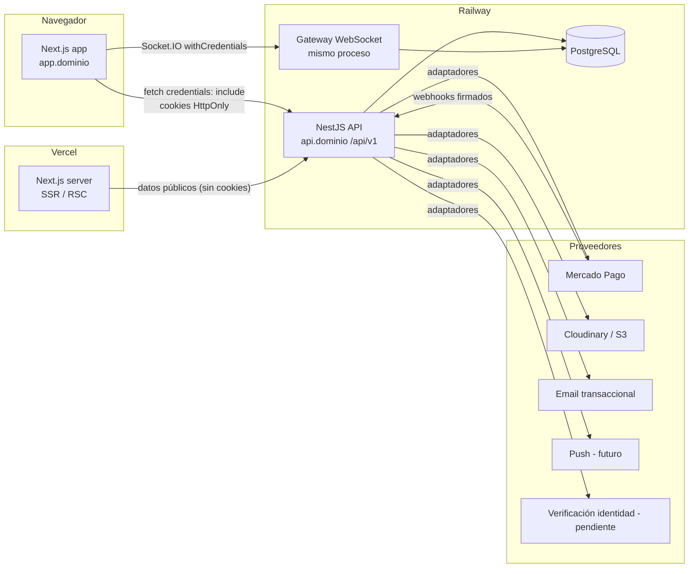
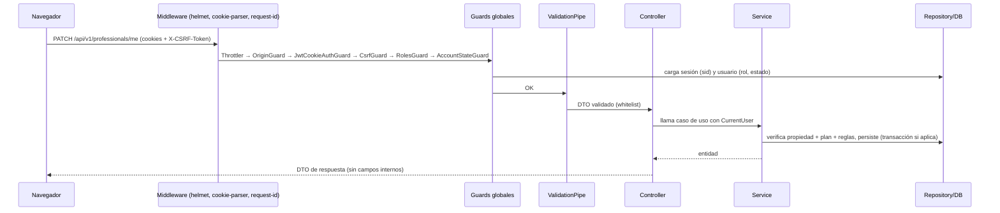
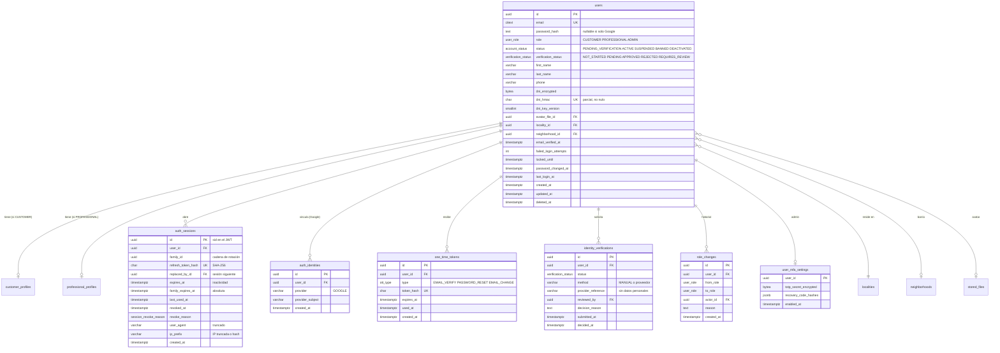
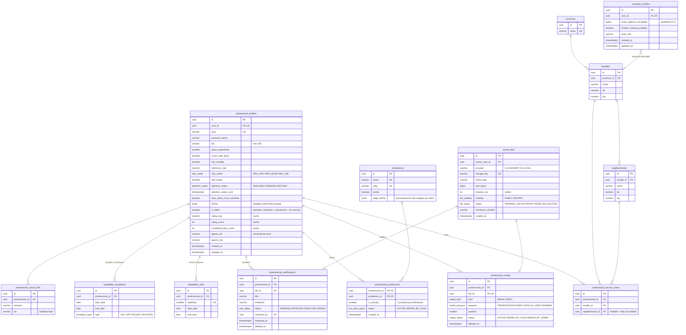
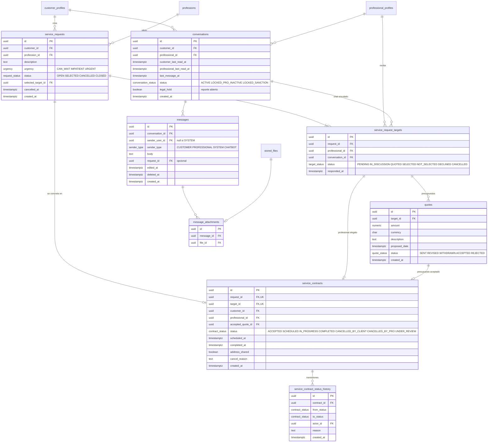
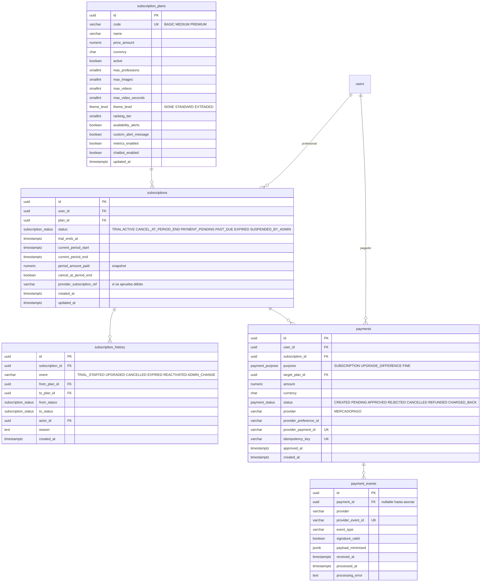
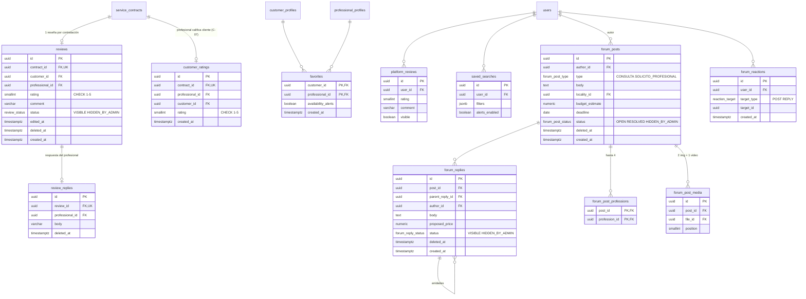
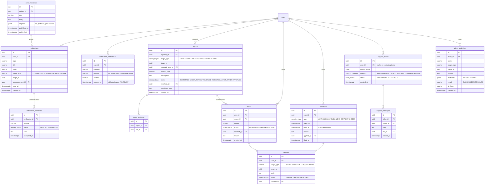
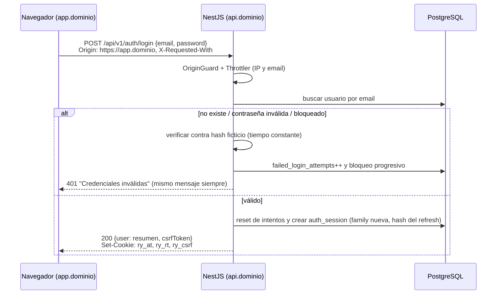
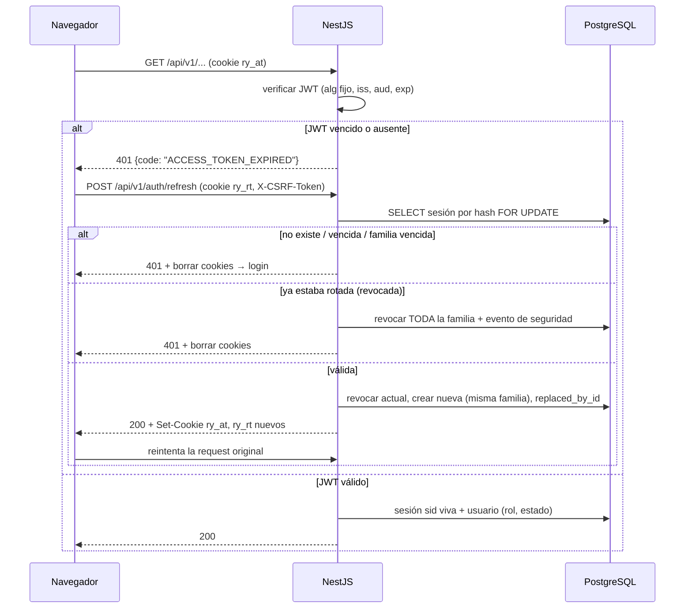

# PLAN BACKEND — REPARA YA / NEXO PRO

**Arquitectura, modelo de datos, autenticación con cookies seguras y roadmap de implementación**

| | |
|---|---|
| Versión | 1.0 — 02/11/2026 |
| Estado | **Propuesta para revisión del fundador.** No autoriza a implementar decisiones marcadas como *pendientes* o *requiere aprobación*. |
| Alcance | Solo backend (NestJS + TypeORM + PostgreSQL), con el contrato que necesita el frontend Next.js. |
| Ubicación sugerida | `docs/PLAN_BACKEND_REPARA_YA_NEXO_PRO.md` |

> **Convenciones de este documento**
> - **[CONFIRMADO]**: el fundador lo respondió expresamente en la documentación.
> - **[PENDIENTE]**: no está resuelto; no se implementa sin decisión.
> - **[CONTRADICCIÓN]**: dos fuentes dicen cosas distintas.
> - **[RIESGO]**: la regla puede producir un resultado delicado (seguridad, privacidad, legal, reputación).
> - **[RECOMENDACIÓN]**: propuesta técnica de este plan; se puede cambiar.
> - Referencias a fuentes: **FI §n** = Flujo Integral, sección n. **CF §n** = Contexto Funcional. **SEG §n** = Guía de Seguridad. **MP §n** = Master Prompt técnico previo. **PP §n** = Prompt de Planificación con cookies.

---

## 1. Resumen ejecutivo

Repara Ya / Nexo Pro es un marketplace de oficios para Córdoba Capital. Gana dinero con suscripciones mensuales de profesionales (Basic / Medium / Premium, sin comisión por trabajo) y combina catálogo público, perfiles con límites por plan, chat en tiempo real, solicitudes y contrataciones, foro, reseñas, notificaciones, moderación con strikes, soporte y un panel de administración. El fundador quiere todo para el lanzamiento, pero la propia documentación pide construirlo por fases sin recortar la visión.

**Recomendaciones principales:**

1. **Monolito modular NestJS** con ~20 módulos de negocio, una capa `common/` mínima y adaptadores para proveedores externos (pagos, almacenamiento, email, push, identidad). Nada de microservicios.
2. **Autenticación por cookies `HttpOnly`** con un **access token JWT de 10 minutos** y un **refresh token opaco** de un solo uso, rotado en cada renovación, guardado solo como hash en una tabla `auth_sessions` con detección de reutilización por familia. Cada request valida además que la sesión (`sid`) siga viva y lee el rol y el estado real del usuario desde la base de datos.
3. **Despliegue en subdominios del mismo dominio propio** (`app.<dominio>` para Next.js y `api.<dominio>` para NestJS). Así frontend y backend son *same-site*, las cookies pueden ser `SameSite=Lax` y se evita `SameSite=None`. Usar `*.vercel.app` + `*.up.railway.app` sin dominio propio rompe este diseño: **es la primera decisión que necesitamos del fundador**.
4. **Defensa CSRF en capas**: `SameSite=Lax`, validación estricta de `Origin`, un header obligatorio y un token CSRF firmado y ligado a la sesión en todos los métodos que modifican datos.
5. **Autorización derivada siempre del backend**: rol + estado de cuenta + estado de verificación + suscripción y plan + propiedad del recurso. Se deniega por defecto.
6. **Modelo de datos** de ~60 tablas agrupadas en 11 dominios, con UUID, `timestamptz` en UTC, soft delete solo donde se justifica, máquinas de estado explícitas e idempotencia en pagos.
7. **Bloqueadores antes de producción**: proveedor y marco legal de la verificación de identidad, política de retención de chats, cobro automático y consentimiento, multa e intereses, política de strikes. El desarrollo puede avanzar con soluciones provisorias aisladas y documentadas, pero estas funciones no se activan sin aprobación.

**Detectamos 26 contradicciones o tensiones** entre las fuentes (sección 4.3). Las más importantes para empezar son: recuperación de contraseña por soporte frente a autoservicio, verificación obligatoria sin proveedor definido, chat en tiempo real con un stack declarado "solo REST", y criterios distintos para reseñas, strikes y clasificación de clientes.

---

## 2. Fuentes leídas y límites del análisis

| Fuente | Archivo | Estado |
|---|---|---|
| Especificación funcional integral v2.0 (incluye el contexto previo y el cuestionario respondido) | `Nexo_Pro_Repara_Ya_Flujo_Integral_Claude_Code.md` | **Leído completo** (secciones 1–30) |
| Contexto funcional inicial | `Repara_Ya_Nexo_Pro_Contexto_Claude_Code.md` | **Leído completo** |
| Guía de seguridad NestJS + TypeORM + PostgreSQL | `guia-seguridad-nestjs-typeorm-postgresql.md` | **Leído completo** |
| Prompt de planificación con cookies | `Prompt_Planificacion_Backend_Repara_Ya_Cookies.md` | **Leído completo**; este documento sigue su sección 13 |
| Master prompt técnico (el "Texto pegado.txt") | Pegado en el mensaje del fundador | **Leído completo**; se usó como antecedente y se revisó críticamente |

**Límites:**

- **No hay repositorio disponible.** No se inspeccionó código existente, versiones instaladas, `package.json` ni estructura real. Claude Code debe validar este plan contra el repositorio antes de implementar (Etapa 1 del prompt final).
- No se verificaron versiones actuales de librerías ni la documentación vigente de Mercado Pago, Cloudinary u otros proveedores. Donde se nombran librerías, son candidatas a verificar.
- Nada de este documento es asesoramiento legal. Los puntos legales se marcan como pendientes.
- Los valores propuestos (duraciones de tokens, límites de rate limit, tamaños) son puntos de partida razonables que hay que validar.

---

## 3. Requisitos y reglas funcionales consolidadas

Síntesis por dominio. No reemplaza a las fuentes; señala dónde está cada regla.

### 3.1 Roles y acceso

| Rol | Puede (resumen) | No puede | Fuente |
|---|---|---|---|
| Visitante | Ver landing, catálogo, perfiles públicos, reseñas, foro (lectura), filtros sin ubicación | Chatear, solicitar, publicar, reaccionar, reportar, favoritos | FI §3.1, §4 |
| Cliente (verificado) | Chat (inicia siempre él), solicitudes a uno o varios profesionales, cancelar, foro, favoritos, avisos de disponibilidad, reseñas, reportes, gestionar datos y ubicación | Ver datos de otros clientes; ver dirección ajena antes de contratación; operar como profesional a la vez | FI §3.2 |
| Profesional (verificado, suscripción vigente) | Perfil público, profesiones según plan, cobertura, tarifas, horarios, medios, certificados, estado de atención, responder solicitudes, contrataciones, responder reseñas, foro, métricas (Premium), chatbot (Premium) | Iniciar chats; operar con suscripción vencida o cuenta suspendida; ocultar teléfono/email (v1); cambiar sus límites | FI §3.3 |
| Admin (único, fundador) | Todo: usuarios, planes, pagos, verificaciones, certificados, moderación, chats bajo reporte, strikes, apelaciones, profesiones, novedades, auditoría | — (acciones sensibles con confirmación y auditoría) | FI §3.4, §19 |

- **[CONFIRMADO]** Roles mutuamente excluyentes; se puede cambiar de rol más adelante (FI §5.2). El proceso de cambio está **[PENDIENTE]**.
- **[CONFIRMADO]** Sesiones en varios dispositivos (FI §5.1).
- **[CONFIRMADO]** Sin verificación aprobada no se opera (FI §4.7, §5.3).

### 3.2 Registro y verificación

- Datos obligatorios para ambos roles: nombre, apellido, foto de perfil, email, DNI, teléfono, provincia, localidad, barrio. El profesional además elige profesión (FI §5.1).
- Google OAuth opcional (FI §5.1).
- Verificación de identidad con DNI frente/dorso y selfie **si existe solución viable**; proveedor, almacenamiento, consentimiento y retención **[PENDIENTE crítico]** (FI §5.3).
- Verificación de email/teléfono: "principalmente no, si es fácil sí" (FI §30, 2.1 p.7–8).
- Recuperación de acceso: "se blanquearán las credenciales con soporte" (FI §5.1, §30) → ver contradicción C-01.

### 3.3 Planes, prueba y suscripciones

| Regla | Detalle | Fuente |
|---|---|---|
| Precios de referencia | Basic $10.000, Medium $15.000, Premium $20.000 ARS/mes, impuestos incluidos, configurables | FI §6.1, §6.3 |
| Prueba | 30 días desde el registro, sin medio de pago; se pierde si no actualiza el perfil (criterio **[PENDIENTE]**); contador en dashboard | FI §6.2 |
| Fin de prueba sin plan | Perfil oculto, mensaje "Elegí un plan para continuar", no se borra nada | FI §6.2 |
| Upgrade | Inmediato. Dentro de 10 días del último pago se paga la diferencia; después, solo al terminar el período | FI §6.4 |
| Downgrade | No existe; solo desuscribirse (sigue hasta fin del período) | FI §6.4 |
| Una suscripción activa por profesional | — | FI §6.4 |
| Impago | Perfil oculto; sin chat, solicitudes ni contrataciones; foro en lectura; reseñas ocultas pero conservadas | FI §6.5 |
| Interés 3 % y multa $8.000 | **[PENDIENTE legal]**, no implementar automáticamente | FI §6.5, §20.2 |

Límites por plan (FI §6.3):

| Límite | Basic | Medium | Premium |
|---|---|---|---|
| Profesiones | 1 | 2 | 3 |
| Imágenes | 5 (2 presentación + 3 trabajos) | 5 (2 + 3) | 4 (ver C-05) |
| Videos (máx. 15 s) | 0 | 1 | 2 (catálogo + presentación) (ver C-05) |
| Personalización | Plantilla fija | Colores, gradientes, tipografías, banner, textos | Ampliada + efectos/animaciones, banner con video |
| Ranking | Base | Preferente | Superior a Medium |
| Avisos de disponibilidad | No | Sí | Sí (mensaje personalizado) |
| Métricas | No | No confirmado | Sí |
| Chatbot/agenda | No | No | Sí |
| Certificados | Sí | Sí | Sí |

Formatos admitidos: PNG, JPG, MP4. Tamaños **[PENDIENTE]**. Personalización solo con controles acotados, **sin CSS libre** (FI §7.3).

### 3.4 Perfil profesional y catálogo

- Perfil: nombre visible, nombre comercial opcional, foto obligatoria, email y teléfono **públicos** (v1), descripción de 200 caracteres, años de experiencia, zonas de cobertura, solo/equipo, tarifa de referencia y modalidad (visita/hora/trabajo), presupuesto gratuito sí/no (FI §7.1).
- Profesiones: catálogo único administrado por el admin; los usuarios no proponen nuevas (FI §7.1).
- Certificados: opcionales, públicos, revisados por admin (FI §7.2).
- Catálogo: oculta suscripciones vencidas; muestra disponibles y no disponibles; filtros combinables por profesión, localidad/barrio, "cerca de mí" (5–10 km, con permiso), disponible ya, verificado, valoración, mínimo de trabajos (FI §9.1). Búsquedas guardadas con avisos.
- Ranking: plan + señales (puntuación, trabajos reales, vistas por día/semana/mes). Pesos **[PENDIENTE]**; patrocinados identificados (FI §9.2).

### 3.5 Disponibilidad

Estados `DISPONIBLE`, `TRABAJANDO`, `DESCANSANDO`; cambio manual; horarios semanales, días libres, feriados y vacaciones con actualización automática; "Disponible" puede vencer; horarios únicos para todas las profesiones (FI §10). Tensión con la contratación activa (C-08).

### 3.6 Solicitudes, contratación y chat

- El cliente inicia desde el perfil o la tarjeta; la profesión queda implícita; se crea chat + solicitud. También puede haber chat sin solicitud (FI §11.1).
- Un cliente puede enviar la misma necesidad a varios profesionales; cada uno recibe notificación y chat; al elegir uno, los demás reciben "El cliente {nombre} ya seleccionó a un profesional" (FI §11.2, §22.4).
- Cancelación por el cliente antes de respuesta con mensaje automático "Ya lo solucioné, disculpas por la molestia" (FI §11.1).
- Estados propuestos por el documento (no aprobados): `REQUESTED → … → COMPLETED / CANCELLED_*` (FI §11.3).
- El profesional marca "finalizado" sin confirmación del cliente; repetir = nueva contratación (FI §11.4).
- Chat: solo 2 participantes, uno por pareja cliente-profesional, texto + imágenes + videos (documentos como imagen), sin audio, lectura/en línea, edición y borrado, reportable, persiste tras finalizar, borrado al mes **[PENDIENTE legal]**, admin lo revisa ante reporte (FI §12).

### 3.7 Foro, reputación y notificaciones

- Foro: tipos *Consulta* y *Solicito Profesional*; hasta 2 imágenes + 1 video < 15 s; hasta 4 profesiones etiquetadas; ubicación, presupuesto y fecha límite opcionales; marcar resuelta bloquea nuevos comentarios; respuestas anidadas; reacciones; lectura pública (FI §13).
- Reseñas: 1–5 estrellas, texto opcional, sin imágenes, una por servicio, editable por el autor, respuesta pública del profesional, reportables, ocultas si el profesional está impago (FI §14.1). Reseñas de la plataforma.
- Clasificación de clientes: "Exigente / Normal / Fácil de complacer" **[RIESGO]**, ver C-07 (FI §14.2).
- Notificaciones internas en tiempo real, persistentes, marcables como leídas (no eliminables), con navegación al recurso; email/WhatsApp/push más adelante, con consentimiento (FI §15).

### 3.8 Moderación, soporte y administración

- Reportes bidireccionales de perfiles, mensajes, publicaciones, comentarios y reseñas (no de contrataciones); evidencia; estados; el denunciante queda anónimo frente al denunciado; apelación (FI §20.1).
- Strikes con peso por gravedad; detección automática como **alerta**, validación humana; suspensión y baneo con umbrales contradictorios (C-09) (FI §20.2).
- Soporte: formulario por categoría, una foto de evidencia, respuesta por plataforma y email, 48–72 h hábiles, sin número de seguimiento (FI §21).
- Novedades segmentadas por rol, profesión y plan (FI §6.2 CF, §21).
- Panel admin con métricas, búsqueda, moderación, pagos, verificaciones y auditoría (FI §19, §23).

### 3.9 Premium avanzado (fase posterior)

Chatbot dentro del mismo chat, identificado como automatizado, configurado por el profesional, sin negociar precios ni proponer horarios, puede confirmar citas solo si el profesional lo autoriza, avisos por WhatsApp/email con consentimiento (FI §16). Métricas Premium (CF §2.2). Se preservan en el modelo, pero quedan fuera del MVP.

---

## 4. Decisiones confirmadas, pendientes, contradicciones y riesgos

### 4.1 Decisiones confirmadas relevantes para el backend

| # | Decisión | Fuente |
|---|---|---|
| D-OK-01 | Monolito modular NestJS + TypeORM + PostgreSQL, REST versionada, Swagger, Jest/Supertest | MP §2–3, CF §10.1 |
| D-OK-02 | Tokens solo en cookies `HttpOnly`; nunca en `localStorage`/`sessionStorage` | Requisito del fundador, PP §4 |
| D-OK-03 | Roles `CUSTOMER`, `PROFESSIONAL`, `ADMIN`, exclusivos | FI §5.2 |
| D-OK-04 | Varias sesiones por usuario | FI §5.1 |
| D-OK-05 | Sin comisión; suscripción mensual del profesional; ARS; Mercado Pago | FI §6.1 |
| D-OK-06 | Prueba de 30 días sin medio de pago | FI §6.2 |
| D-OK-07 | Precios y límites configurables, no en código | MP §7.6, PP §2 |
| D-OK-08 | Una conversación por pareja cliente-profesional; solo el cliente inicia | FI §12 |
| D-OK-09 | La falta de pago no borra perfil, reseñas ni historial | FI §6.5 |
| D-OK-10 | Profesiones administradas solo por el admin | FI §7.1 |
| D-OK-11 | Un único admin al inicio | FI §19 |
| D-OK-12 | Email y teléfono del profesional públicos en v1 | FI §7.1 |
| D-OK-13 | Archivos PNG/JPG/MP4; videos de 15 s como máximo | FI §6.3 |

### 4.2 Decisiones pendientes (resumen; detalle y preguntas en la sección 17)

| # | Tema | Bloquea | Solución provisoria segura |
|---|---|---|---|
| P-01 | ~~Dominio propio~~ **RESUELTO (02/11/2026): habrá dominio propio** → `app.<dominio>` + `api.<dominio>` | — | Diseño de la sección 9 confirmado |
| P-02 | Proveedor y flujo de verificación de identidad | Lanzamiento | Estado de verificación + revisión manual del admin **sin almacenar imágenes de DNI** hasta que haya decisión legal; bypass solo en dev/test |
| P-03 | Verificación de email y autoservicio de contraseña | Fase Auth | Ver C-01 (recomendación: sí) |
| P-04 | Máquina de estados de solicitudes y contrataciones | Fase Contrataciones | Implementar la propuesta de FI §11.3 detrás de una tabla de transiciones fácil de cambiar |
| P-05 | Retención y borrado de chats | Activar borrado automático | No borrar; dejar el job de retención apagado por config |
| P-06 | Cobro automático / débito recurrente | Fase Pagos | Solo pago manual (checkout) por período |
| P-07 | Interés 3 % y multa $8.000 | Fase Pagos/Moderación | No implementar cálculo; modelo de pago con `purpose` extensible |
| P-08 | Política de strikes y sanciones | Sanciones automáticas | Strikes y sanciones solo manuales por el admin; detección automática solo como alerta |
| P-09 | Clasificación de clientes | Exponerla | Calcular internamente sin exponer hasta definir mínimos y transparencia |
| P-10 | Ranking del catálogo | Orden final | Orden provisional: plan → rating bayesiano → trabajos → aleatorio estable por día |
| P-11 | Ubicación en tiempo real y "cerca de mí" | Geolocalización | Solo zona declarada (localidad/barrio) + coordenadas aproximadas del barrio |
| P-12 | Cambio de rol | Cambio de rol | Solo por el admin, auditado |
| P-13 | Marca definitiva | Textos, dominio, nombres de cookies | Prefijo neutro `ry_` o configurable |
| P-14 | Límites técnicos de archivos | Uploads | Imágenes ≤ 5 MB, videos ≤ 30 MB / 15 s (a validar) |
| P-15 | Canales externos de notificación | Email/WhatsApp/push | Solo notificaciones internas + email transaccional de auth |

### 4.3 Contradicciones y tensiones detectadas

| # | Contradicción | Afecta | Propuesta | ¿Requiere aprobación? |
|---|---|---|---|---|
| C-01 | Reset autoservicio vs blanqueo por soporte | Auth, soporte | **DECIDIDO (02/11/2026): el admin blanquea las credenciales; puede cambiar a futuro.** Implementación segura: el admin nunca ve ni elige la contraseña. Tras verificar la identidad del usuario, ejecuta `POST /admin/users/:id/password-reset`, que genera un enlace de un solo uso (30 min) enviado al email registrado; al usarlo se revocan todas las sesiones. Motivo obligatorio y auditoría. El endpoint de autoservicio queda diseñado pero apagado por config (`PASSWORD_SELF_RESET_ENABLED=false`) | Resuelto |
| C-02 | "Sin verificación no se puede crear cuenta ni navegar" vs catálogo y foro públicos para visitantes; y el proveedor de identidad no está definido | Registro, todo el flujo operativo | La cuenta se crea en estado `PENDING_VERIFICATION`: puede iniciar sesión, ver su estado y completar la verificación, pero no operar. La navegación pública sigue abierta. Sin proveedor, nadie podría operar: ver P-02 | **Sí** (P-02) |
| C-03 | Cliente "gratis el primer mes con plan Basic; si no abona no podrá usar Nexo Pro" vs modelo de negocio "cliente gratuito, cobro solo a profesionales" (FI §6.1, §27.2) | Suscripciones, modelo de datos | Modelar suscripciones **solo para profesionales**. Dejar `subscriptions.user_id` genérico para no cerrar la puerta | **Sí** |
| C-04 | Prueba sin tarjeta vs "cobro automático al finalizar la prueba" (FI §6.2) | Pagos, legal | Sin cobro automático. Al fin de la prueba se pide un checkout manual | **Sí** |
| C-05 | Contenido Premium: CF dice "hasta 3 videos"; el cuestionario dice "2 videos + 4 imágenes" y en la misma frase "las 5 imágenes". Además Premium tendría **menos** imágenes (4) que Basic (5) | Límites de plan, uploads | Límites como datos configurables. Valor inicial a confirmar: Premium 5 imágenes + 2 videos | **Sí** |
| C-06 | Reseñas: CF §4.6 "solo después de que el profesional marque Finalizado"; FI §14.1 "en cualquier momento, una por servicio" | Reseñas, modelo | Reseña ligada a una contratación (`service_contract`) en cualquier estado posterior a `ACCEPTED` (incluye cancelada y no-show), una por contratación. Así se evita la reseña sin interacción real | **Sí** |
| C-07 | Clasificación de clientes: CF §4.2 dice que se basa en las calificaciones **que el cliente da** a los profesionales; FI §8 y §14.2 dicen que la dan **los profesionales al cliente** | Reputación, modelo, privacidad | Si es la versión FI, hace falta una tabla `customer_ratings` (el profesional califica al cliente). Mínimo de evaluaciones, explicación visible y apelación antes de exponerla | **Sí** |
| C-08 | Disponibilidad: "el sistema no cambia el estado por una contratación activa" vs "pasa a Trabajando al aceptar una solicitud" (FI §10) | Disponibilidad, contrataciones | Al pasar una contratación a `IN_PROGRESS`, sugerir (no forzar) el cambio a `TRABAJANDO`; configurable | **Sí** |
| C-09 | Strikes: CF §6.6 "3 incidencias = baneo temporal, 5 = permanente"; FI §20.2 "5 strikes = suspensión" y también "5 strikes = baneo permanente" | Moderación | Umbrales configurables; en la v1 todo lo decide el admin manualmente | **Sí** |
| C-10 | Chat borrado al mes vs revisión del admin ante reportes, apelaciones y conservar "historial de contrataciones siempre" (FI §8, §12) | Chat, moderación, legal | No borrar mientras haya un reporte o apelación abiertos (*legal hold*); el job de borrado queda apagado hasta la validación legal | **Sí** |
| C-11 | El fundador no quiere historial completo de estados (FI §11.4) vs el master prompt pide `service_request_status_history` y la propia FI pide auditar eventos críticos | Contrataciones, soporte | Guardar solo transiciones de estado (pocas filas por contratación): necesarias para disputas y métricas. No guardar ediciones de campos | **Sí** (bajo riesgo) |
| C-12 | Profesional impago "no puede finalizar trabajos ni ver chats" vs el cliente con una contratación en curso o una cita agendada (FI §6.5, §16) | Contrataciones, chat | El cliente conserva acceso de lectura a su chat; el profesional queda bloqueado; las contrataciones abiertas pasan a un estado visible para el cliente. El admin puede habilitar el acceso puntual | **Sí** |
| C-13 | El profesional ve el perfil del cliente "solo cuando le solicita un servicio" (CF §5.2) vs "cuando el cliente lo contacta" (FI §8), que incluye un chat sin solicitud | Privacidad | Acceso al perfil del cliente cuando existe una conversación iniciada por ese cliente; la dirección exacta solo con contratación aceptada | **Sí** |
| C-14 | Chat en tiempo real y notificaciones en tiempo real (FI §12, §15) vs stack "REST API" del master prompt | Arquitectura, dependencias | Agregar un gateway WebSocket (Socket.IO vía `@nestjs/websockets`) solo para eventos; los envíos siguen pasando por servicios con las mismas reglas | **Sí** (nueva dependencia) |
| C-15 | Master prompt: `PORT` por defecto 3000; Next.js usa 3000 por defecto en desarrollo | DX | Backend en `PORT=3001` en desarrollo | No |
| C-16 | Admin puede "eliminar cuentas" (CF §6.3) vs conservar pagos, reportes y contrataciones para disputas | Usuarios, legal | Eliminación = soft delete + anonimización de datos personales; se conservan registros financieros y de moderación con referencia seudonimizada | **Sí** |
| C-17 | Foro: borrar publicación elimina respuestas "en cascada" vs conservar evidencia de moderación (FI §13.1) | Foro, moderación | Soft delete en cascada (oculto para todos), evidencia conservada si hay reportes | No (técnica) |
| C-18 | El profesional puede "guardar/descargar datos del cliente" (FI §8) vs minimización y privacidad | Privacidad, legal | No implementar descarga hasta la revisión legal | **Sí** |
| C-19 | Email y teléfono del profesional públicos (decisión) vs riesgo de scraping masivo | Privacidad | Respetar la decisión; mitigar con rate limit en perfiles y sin exponerlos en los listados del catálogo (solo en el detalle). Marcado como riesgo | Informativo |
| C-20 | El master prompt pide la tabla `conversation_participants`; el chat tiene siempre exactamente 2 participantes fijos | Modelo | No crear la tabla: `conversations.customer_id` + `professional_id` + estado de lectura por lado. Se puede agregar si un día hay chats grupales | No (técnica) |
| C-21 | El master prompt pide `message_reports` separado; FI pide reportar perfiles, mensajes, publicaciones, comentarios y reseñas con el mismo flujo | Modelo | Un único `reports` polimórfico (`target_type`, `target_id`) | No (técnica) |
| C-22 | El master prompt pide `admin_profiles`; con un único admin no hay datos propios del perfil | Modelo | No crearla; los datos de MFA del admin van en `user_mfa_settings` | No (técnica) |
| C-23 | Prueba "se pierde si no actualiza el perfil" sin criterio | Suscripciones | Criterio provisional: perfil mínimo completo (foto, profesión, descripción, 1 zona) dentro de N días; configurable y apagado hasta decidir | **Sí** |
| C-24 | Upgrade "pagar la diferencia" sin fórmula; ¿qué pasa si el pago está pendiente o falla? | Pagos | Diferencia = precio nuevo − precio pagado del período actual (sin prorrateo por días), solo dentro de 10 días, aplicada cuando el pago esté **aprobado** por webhook | **Sí** |
| C-25 | Cuenta comprometida: "dar de alta una cuenta nueva con los días restantes" vs prohibición de cuentas duplicadas | Auth, suscripciones | Recuperar la misma cuenta (revocar sesiones, reset, revisión del admin) en lugar de crear otra | **Sí** |
| C-26 | Master prompt Etapa 4 "recuperación de contraseña y verificación de email" sin email provider definido | Auth | Interfaz `MailProvider` con adaptador de consola/archivo en dev y test; el proveedor real se conecta con credenciales | No |

### 4.4 Riesgos principales

| # | Riesgo | Impacto | Mitigación |
|---|---|---|---|
| R-01 | Almacenar DNI e imágenes biométricas sin marco legal | Legal, reputación, incidente grave | No almacenar hasta decisión (P-02); si se aprueba, proveedor externo, mínimo dato local (estado + referencia), cifrado |
| R-02 | Cookies entre dominios distintos (`vercel.app` vs `railway.app`) | Auth rota en Safari/Chrome o `SameSite=None` con más CSRF | Dominio propio con subdominios (P-01) |
| R-03 | IDOR/BOLA en chats, solicitudes, medios | Fuga de datos | Ownership en servicios + tests e2e obligatorios por recurso |
| R-04 | Webhooks de pago falsos o duplicados | Fraude, estados inconsistentes | Verificación de firma, consulta al proveedor, idempotencia por `provider_event_id` |
| R-05 | Sanciones automáticas por reportes falsos | Reputación, daño a usuarios | Solo alertas automáticas; decisión humana auditada |
| R-06 | Alcance completo "para el lanzamiento" | Plazos, calidad | MVP backend + fases (sección 16) |
| R-07 | Clasificación de clientes con pocos datos | Discriminación, represalias | No exponer hasta definir (P-09) |
| R-08 | Contenido de usuarios (foro, chat, perfiles) con XSS | Robo de sesión indirecto, defacement | Texto plano en backend, escape en frontend, CSP, sin HTML/CSS libre |
| R-09 | Admin único con acceso total | Cuenta del admin = llave maestra | MFA obligatorio para admin, sesiones cortas, auditoría |
| R-10 | Personalización visual libre | XSS vía CSS, accesibilidad | Tema como JSON validado contra una lista cerrada de opciones |

---

## 5. Arquitectura recomendada y justificación

### 5.1 Vista general



### 5.2 Decisiones de arquitectura

| Decisión | Opción elegida | Alternativas | Por qué |
|---|---|---|---|
| Estilo | Monolito modular | Microservicios | Un solo desarrollador aprendiendo; transacciones simples; despliegue único |
| Capas por módulo | Controller → Service → Repository TypeORM (inyectado con `@InjectRepository` o repositorio propio cuando haya queries complejas) | Arquitectura hexagonal completa | Suficiente separación sin ceremonia. Los puertos/adaptadores se usan solo para proveedores externos |
| Integraciones | Interfaz (token de inyección) + adaptador real + adaptador fake | Llamar SDKs directamente desde servicios | Permite tests y desarrollo sin credenciales (MP §13) |
| Tiempo real | Gateway Socket.IO en el mismo proceso, solo para empujar eventos | Polling; servicio aparte | Chat y notificaciones en tiempo real son requisito (FI §12, §15). Con más de una instancia se agrega el adaptador Redis |
| Jobs programados | `@nestjs/schedule` (cron en proceso) con locks en PostgreSQL (`pg_try_advisory_lock`) | Cola Redis/BullMQ | Pocos jobs (vencimientos, disponibilidad, limpieza). BullMQ cuando haya email/push masivo |
| Búsqueda | SQL con índices + filtros; distancia con lat/lng y fórmula de Haversine | PostGIS, Elasticsearch | Volumen inicial bajo (Córdoba). PostGIS si aparece "cerca de mí" fino (P-11) |
| Configuración | `@nestjs/config` + validación de esquema (Joi o class-validator) + config tipada por namespace | `process.env` directo | Falla al iniciar si falta una variable crítica (MP §4.3) |
| Logs | Logger estructurado JSON (p. ej. `nestjs-pino`) con redacción de campos | `console.log` | Redacción de cookies, tokens, contraseñas, DNI (SEG §20.1) |

### 5.3 Flujo de una request autenticada



---

## 6. Estructura de carpetas propuesta

Cambios respecto del master prompt, justificados:

- `catalog/` como módulo propio de lectura pública (búsqueda, ranking) separado de `professionals/` (escritura del perfil): son consultas diferentes y con distintas reglas de exposición.
- `integrations/` agrupa los adaptadores de proveedores para no mezclarlos con módulos de negocio.
- Se eliminan `customers/` y `admin/` como módulos "de perfil" separados si quedan vacíos: `customers/` sí existe (perfil del cliente, ubicación, clasificación); `admin/` existe como **módulo de endpoints de backoffice** que orquesta a los demás servicios.
- `contracts/` se llama `service-contracts/` para no confundirse con contratos/interfaces de TypeScript.
- `messages/` se fusiona en `chat/` (conversaciones + mensajes + gateway) porque no tienen sentido por separado.
- `moderation/` incluye reports, strikes, sanctions y appeals (un mismo flujo).

```
src/
├── main.ts                      # bootstrap: helmet, cookie-parser, CORS, prefix, versioning, swagger (no prod), shutdown hooks
├── app.module.ts
├── config/                      # namespaces tipados + validación del entorno
│   ├── app.config.ts            # PORT, API_PREFIX, NODE_ENV, FRONTEND_ORIGINS
│   ├── auth.config.ts           # secretos JWT, duraciones, nombres y atributos de cookies, CSRF
│   ├── database.config.ts
│   ├── storage.config.ts
│   ├── mail.config.ts
│   ├── payments.config.ts
│   └── env.validation.ts
├── common/
│   ├── decorators/              # @Public, @CurrentUser, @Roles, @RequireVerified, @RequireActiveSubscription, @SkipCsrf
│   ├── guards/                  # OriginGuard, JwtCookieAuthGuard, CsrfGuard, RolesGuard, AccountStateGuard, SubscriptionGuard
│   ├── filters/                 # AllExceptionsFilter (formato uniforme, sin stack en prod, mapea errores de Postgres)
│   ├── interceptors/            # request-id / logging
│   ├── pagination/              # PageQueryDto, CursorQueryDto, Paginated<T>
│   ├── crypto/                  # hash de tokens (SHA-256), HMAC, cifrado AES-256-GCM para campos sensibles
│   ├── enums/
│   └── utils/
├── database/
│   ├── data-source.ts           # usado por la CLI de migraciones
│   ├── migrations/
│   ├── seeds/                   # datos ficticios: provincias/localidades de Córdoba, profesiones, planes, usuarios demo
│   └── naming.strategy.ts       # snake_case
├── integrations/
│   ├── payments/                # PaymentProvider (interfaz) + mercadopago.adapter + fake.adapter
│   ├── storage/                 # StorageProvider + cloudinary/s3 adapter + local/fake
│   ├── mail/                    # MailProvider + templates/ + console adapter
│   ├── push/                    # PushProvider (noop por defecto)
│   └── identity/                # IdentityVerificationProvider (manual por defecto)
├── auth/                        # registro, login, refresh, logout, sesiones, CSRF, reset, verificación email, Google OAuth
├── users/                       # identidad base, cambio de rol, estado de cuenta
├── identity-verification/
├── customers/
├── professionals/               # perfil, profesiones del profesional, cobertura, medios, certificados, tema
├── catalog/                     # búsqueda pública, filtros, ranking, búsquedas guardadas
├── professions/
├── locations/                   # provincias, localidades, barrios
├── availability/                # horarios, excepciones, estado de atención + job
├── uploads/                     # archivos: subida firmada, validación, propiedad, visibilidad
├── service-requests/            # solicitudes, destinatarios, presupuestos
├── service-contracts/           # contrataciones, máquina de estados, historial
├── chat/                        # conversaciones, mensajes, adjuntos, lecturas, gateway WebSocket
├── subscriptions/               # planes, límites, prueba, suscripciones, historial, jobs de vencimiento
├── payments/                    # pagos, webhooks, eventos, reconciliación
├── reviews/                     # reseñas, respuestas, calificación a clientes, reseñas de plataforma
├── favorites/                   # favoritos y avisos de disponibilidad
├── forum/
├── notifications/               # notificaciones, preferencias, entregas, novedades
├── moderation/                  # reportes, strikes, sanciones, apelaciones
├── support/
├── admin/                       # endpoints de backoffice (orquesta otros servicios)
├── audit/                       # AuditService (append-only) usado por todos
├── metrics/                     # eventos y agregados (vistas de perfil, impresiones) — fase posterior
└── health/                      # liveness / readiness (DB)
```

Estructura interna de un módulo (crear solo lo necesario):

```
professionals/
├── professionals.module.ts
├── professionals.controller.ts        # /professionals/me (dueño)
├── professional-media.controller.ts
├── professionals.service.ts
├── professional-media.service.ts
├── plan-limits.policy.ts              # consulta los límites del plan vigente
├── entities/
├── dto/                               # create/update/response
└── tests/                             # *.spec.ts unitarios; e2e en /test
```

---

## 7. Módulos backend y responsabilidades

| Módulo | Responsabilidad | Depende de | Fase |
|---|---|---|---|
| `config`, `common`, `health` | Bootstrap, validación de entorno, errores, guards base | — | 1 |
| `database` | DataSource, migraciones, seeds | config | 1 |
| `audit` | Registrar acciones sensibles (append-only) | database | 1 |
| `users` | Identidad, estado de cuenta, rol, cambio de rol | database, audit | 2 |
| `auth` | Registro, login, cookies, sesiones, refresh, logout, CSRF, reset, verificación de email, OAuth | users, mail | 2 |
| `integrations/mail` | Envío con templates; adaptador de consola en dev | config | 2 |
| `locations`, `professions` | Catálogos maestros (seed + admin) | database | 3 |
| `uploads` + `integrations/storage` | Archivos: validación, propiedad, visibilidad, URLs firmadas | users | 3 |
| `identity-verification` + `integrations/identity` | Estado de verificación, revisión manual, futuro proveedor | users, uploads, audit | 3 |
| `customers` | Perfil del cliente, ubicación declarada, acceso del profesional | users, locations | 3 |
| `subscriptions` | Planes, límites, prueba, estado de suscripción, jobs | users, audit | 3 (planes y prueba) / 5 (pago) |
| `professionals` | Perfil, profesiones, cobertura, medios, certificados, tema | users, professions, locations, uploads, subscriptions (límites) | 3 |
| `availability` | Horarios, excepciones, estado de atención, job automático | professionals | 3 |
| `catalog` | Búsqueda pública, filtros, ranking, detalle público | professionals, subscriptions, reviews (agregados) | 3 |
| `chat` | Conversaciones, mensajes, adjuntos, lecturas, WebSocket | customers, professionals, uploads, subscriptions | 4 |
| `service-requests` | Solicitudes multi-destinatario, presupuestos | chat, professionals | 4 |
| `service-contracts` | Contratación, máquina de estados, historial | service-requests | 4 |
| `notifications` | Internas en tiempo real, preferencias, novedades, entregas externas | chat (gateway), users | 4 |
| `payments` + `integrations/payments` | Checkout, webhooks, eventos idempotentes, reconciliación | subscriptions | 5 |
| `reviews` | Reseñas, respuestas, calificación de clientes, agregados | service-contracts | 6 |
| `favorites` | Favoritos, seguimiento y avisos de disponibilidad | professionals, notifications | 6 |
| `forum` | Publicaciones, respuestas anidadas, reacciones, medios | users, professions, uploads | 6 |
| `moderation` | Reportes, strikes, sanciones, apelaciones | todos los contenidos, audit | 7 |
| `support` | Tickets y mensajes de soporte, contacto público | users, mail | 7 |
| `admin` | Backoffice: búsqueda, métricas, gestión | todos | 7 |
| `metrics` | Eventos y agregados para Premium y admin | catalog, professionals | 8 |
| Chatbot / agenda / WhatsApp / push | Premium avanzado | chat, availability, notifications | 9 (requiere decisiones) |

**Regla anti-dependencias circulares:** los módulos de "abajo" (users, uploads, subscriptions) nunca importan a los de "arriba" (chat, reviews). Cuando un módulo bajo necesita reaccionar a algo de arriba se usan eventos internos (`@nestjs/event-emitter`) — por ejemplo `contract.completed` → `reviews` habilita la reseña, `notifications` notifica.

---

## 8. Modelo de datos

### 8.1 Políticas generales

| Política | Decisión | Justificación |
|---|---|---|
| Identificadores | `uuid` generado por PostgreSQL (`gen_random_uuid()`); UUIDv7 si la versión de PG/librería lo permite | No enumerables (dificulta IDOR por adivinación, aunque **no reemplaza** el control de propiedad); v7 mejora la localidad de índices |
| Slugs públicos | `professional_profiles.slug` único para URLs compartibles | La URL del perfil se comparte (FI §4.7 CF) |
| Fechas | `timestamptz` siempre, guardadas en UTC; la API devuelve ISO 8601 con `Z`; el frontend convierte a `America/Argentina/Cordoba` | No depender de la zona del servidor (MP §6.3). Horarios semanales del profesional como `time` + zona fija del profesional |
| Dinero | `numeric(12,2)` + `currency char(3)` (`ARS`); nunca `float` | Exactitud |
| Nombres | Tablas y columnas en `snake_case` (naming strategy), entidades en `PascalCase` | Convención PostgreSQL |
| Email | `citext` único (o `lower(email)` con índice único) | Evitar duplicados por mayúsculas |
| Enums | Enums de PostgreSQL para estados estables; tablas de catálogo para listas que el admin edita (profesiones, motivos de reporte) | Integridad + flexibilidad |
| Auditoría de filas | `created_at`, `updated_at` en todas; `created_by`/`updated_by` solo donde el admin edita | Sin ruido |
| Soft delete | **Sí**: `users`, `professional_media`, `forum_posts`, `forum_replies`, `reviews`, `review_replies`, `messages` (borrado del usuario = oculto), `professional_certifications`, `announcements`. **No** (se conservan siempre, inmutables o con estado): `payments`, `payment_events`, `subscription_history`, `admin_audit_logs`, `service_contract_status_history`, `reports`, `strikes`, `sanctions`, `auth_sessions` (se revocan y se purgan por job). **Borrado físico**: `one_time_tokens` y sesiones vencidas (job), `favorites`, `forum_reactions` | El soft delete indiscriminado complica unicidad y privacidad; los registros financieros y de moderación necesitan historial |
| Unicidad con soft delete | Índices únicos **parciales** `WHERE deleted_at IS NULL` | Permite recrear tras borrar |
| Datos sensibles | DNI cifrado con AES-256-GCM (clave fuera del repo, versión de clave por fila) + `dni_hmac` (HMAC-SHA256 con otra clave) para detectar duplicados. Ver sección 9.9 y P-02 | Detectar cuentas duplicadas sin guardar el DNI en claro |

### 8.2 Diagramas ER

Se divide en dominios para que sea legible. Las relaciones entre dominios se repiten con la entidad compartida.

#### 8.2.1 Identidad, autenticación y verificación



Notas:
- `role` vive en `users` porque es exclusivo (D-OK-03). Un `CHECK` + lógica de servicio garantiza que exista solo el perfil del rol activo; al cambiar de rol (P-12) el perfil anterior **no se borra**, queda inactivo para conservar el historial, y se registra en `role_changes`.
- `verification_status` se duplica en `users` (desnormalizado) para que los guards no hagan un join; la fuente de la verdad del proceso es `identity_verifications`. Se actualizan en la misma transacción.
- Nombre, apellido, email, teléfono y DNI viven **solo** en `users` (MP §7.1).

#### 8.2.2 Perfiles, profesiones, territorio, disponibilidad y archivos



Notas:
- `stored_files` centraliza propiedad, tipo, tamaño y visibilidad de **todos** los archivos (avatar, medios, certificados, adjuntos de chat, foro, evidencia). Cada uso referencia un `file_id`; así el control de acceso a archivos es uno solo.
- Límites del plan (profesiones, imágenes, videos) **no** se validan con constraints de base de datos: los aplica el servicio leyendo `subscription_plans` dentro de una transacción con `SELECT … FOR UPDATE` sobre el perfil para evitar condiciones de carrera.
- Al vencer o cambiar de plan, el excedente pasa a `HIDDEN_BY_PLAN` (no se borra), siguiendo FI §6.4. El orden de ocultamiento (más recientes primero o por `position`) es **[PENDIENTE]** (FI §27.19).

#### 8.2.3 Solicitudes, contrataciones y chat



Notas:
- **Unicidad de la conversación**: `UNIQUE (customer_id, professional_id)`. La creación usa `INSERT … ON CONFLICT DO NOTHING` + lectura, para que dos clics simultáneos no creen dos chats.
- Solo el cliente crea conversaciones (regla de servicio + test). El profesional nunca tiene endpoint de creación.
- **Solicitud multi-destinatario**: una `service_request` (la necesidad del cliente) tiene N `service_request_targets` (uno por profesional, cada uno vinculado al chat de esa pareja). Al seleccionar un target: transacción que marca `SELECTED`, pone los demás en `NOT_SELECTED`, crea la `service_contract`, inserta mensajes de sistema en los otros chats ("El cliente {nombre} ya seleccionó a un profesional") y emite notificaciones. Que las otras solicitudes queden cerradas o abiertas es **[PENDIENTE]** (FI §22.4); la propuesta es `NOT_SELECTED` (cerradas para esa necesidad, chat sigue activo).
- `quote_items` **no** se crea: los presupuestos se acuerdan por chat y no hay requisito de ítems (MP §7.4 lo deja "si corresponde").
- Las transiciones válidas de `service_contracts` viven en una tabla de transiciones en código (`contract-state-machine.ts`) con actor permitido por transición; cualquier otra transición devuelve 409.

#### 8.2.4 Suscripciones y pagos



Notas:
- **Una suscripción viva por profesional**: índice único parcial `UNIQUE (user_id) WHERE status NOT IN ('EXPIRED')`.
- Los precios y límites se leen de `subscription_plans` (editable solo por el admin, auditado). El importe cobrado se guarda como snapshot en `payments.amount` y `subscriptions.period_amount_paid`, así un cambio de precio no altera el pasado.
- **Idempotencia del webhook**: `payment_events.provider_event_id` único; si llega repetido se responde 200 sin reprocesar. El estado del pago se confirma **consultando la API del proveedor** con el id recibido, no confiando en el cuerpo del webhook ni en el frontend.
- `purpose = FINE` existe para no romper el modelo, pero **no se usa** hasta P-07.

#### 8.2.5 Reputación, favoritos y foro



Notas:
- `reviews.contract_id` único: "una reseña por servicio" (FI §14.1). Ver C-06.
- `rating_avg`, `rating_count` y `completed_jobs_count` en `professional_profiles` se actualizan en la misma transacción que crea, edita u oculta una reseña o completa una contratación, y un job nocturno los recalcula para corregir desvíos.
- `forum_reactions`: `UNIQUE (user_id, target_type, target_id)`.
- La clasificación de clientes se **calcula** (vista o consulta) desde `customer_ratings`, no se guarda como columna editable.

#### 8.2.6 Notificaciones, moderación, soporte y auditoría



Notas:
- `admin_audit_logs` es **append-only**: el usuario de base de datos de la aplicación tiene solo `INSERT` y `SELECT` sobre esa tabla (sin `UPDATE`/`DELETE`). Además de las acciones del admin, registra eventos de seguridad (reutilización de refresh token, bloqueo de cuenta, cambio de contraseña). Si se prefiere separar, `security_events` como tabla aparte.
- La identidad del denunciante nunca sale en los DTOs que ve el denunciado (FI §20.1).

#### 8.2.7 Futuro (modelado, no implementado en el MVP)

`chatbot_configs` (professional_id, enabled, context, canned_responses, auto_confirm_appointments), `appointments` (contract_id, starts_at, location_text, status, created_by `PRO`/`CHATBOT`), `profile_metrics_daily` (professional_id, date, views_auth, views_anon, search_impressions, top_impressions, requests, completed), `sponsored_placements`. Se crean cuando se aprueben sus reglas (FI §16, §23).

### 8.3 Constraints e índices críticos

| Tabla | Constraint / índice | Motivo |
|---|---|---|
| `users` | `UNIQUE(lower(email)) WHERE deleted_at IS NULL`; `UNIQUE(dni_hmac) WHERE dni_hmac IS NOT NULL AND deleted_at IS NULL` | Duplicados de cuenta (FI §5.4) |
| `auth_sessions` | `UNIQUE(refresh_token_hash)`; índice `(user_id) WHERE revoked_at IS NULL`; índice `(family_id)` | Búsqueda por hash, logout global, revocar familia |
| `one_time_tokens` | `UNIQUE(token_hash)`; índice `(user_id, type) WHERE used_at IS NULL` | Invalidar anteriores |
| `professional_profiles` | `UNIQUE(user_id)`, `UNIQUE(slug)`; índice `(is_listed, ranking…)`; `CHECK (char_length(bio) <= 200)` | Catálogo |
| `professional_professions` | PK compuesta; `UNIQUE(professional_id) WHERE is_primary` | Una profesión principal |
| `conversations` | `UNIQUE(customer_id, professional_id)`; índice `(professional_id, last_message_at DESC)` y `(customer_id, last_message_at DESC)` | Un chat por pareja; bandejas |
| `messages` | índice `(conversation_id, created_at DESC, id)` | Paginación por cursor |
| `service_request_targets` | `UNIQUE(request_id, professional_id)` | No duplicar destinatario |
| `service_contracts` | `UNIQUE(request_id)`, `UNIQUE(target_id)` | Un solo profesional elegido por solicitud (FI §11.2) |
| `subscriptions` | `UNIQUE(user_id) WHERE status <> 'EXPIRED'` | Una suscripción viva |
| `payments` | `UNIQUE(provider_payment_id)`, `UNIQUE(idempotency_key)` | Idempotencia |
| `payment_events` | `UNIQUE(provider, provider_event_id)` | Webhooks duplicados |
| `reviews` | `UNIQUE(contract_id) WHERE deleted_at IS NULL`; `CHECK (rating BETWEEN 1 AND 5)` | Una reseña por servicio |
| `favorites` | PK `(customer_id, professional_id)` | — |
| `forum_reactions` | `UNIQUE(user_id, target_type, target_id)` | Un "me gusta" por usuario |
| `notifications` | índice `(user_id, read_at, created_at DESC)` | Contador de no leídas |
| Todas las FK | Índice en cada columna FK; `ON DELETE RESTRICT` por defecto (los borrados son lógicos) | Integridad |

### 8.4 Operaciones transaccionales

| Operación | Qué incluye la transacción |
|---|---|
| Registro | `users` + perfil del rol + `professional_professions` (profesión inicial) + `subscriptions` (TRIAL) + `one_time_tokens` (verificación de email) + auditoría |
| Rotación de refresh | `SELECT … FOR UPDATE` de la sesión, marcar revocada, crear la nueva, enlazar `replaced_by_id` |
| Seleccionar profesional | target `SELECTED` + otros `NOT_SELECTED` + `service_requests.status` + `service_contracts` + historial + mensajes de sistema |
| Cambio de estado de contratación | validar transición con lock + actualizar + historial + evento de dominio (después del commit) |
| Procesar webhook de pago | `payment_events` (insert idempotente) + `payments` + `subscriptions` + `subscription_history` + reaplicar límites (desocultar contenido) |
| Vencimiento de suscripción (job) | `subscriptions` + `subscription_history` + `professional_profiles.is_listed` + ocultar excedente + bloquear conversaciones |
| Aplicar sanción | `sanctions` + `strikes` + `users.status` + revocar todas las sesiones + auditoría |
| Crear/editar/ocultar reseña | `reviews` + recálculo de `rating_avg/rating_count` |
| Subir medio | verificar límite del plan con lock del perfil + `professional_media` |
| Cambio de rol | `users.role` + desactivar perfil anterior + crear/activar el nuevo + `role_changes` + revocar sesiones + auditoría |
| Eliminar cuenta | soft delete + anonimizar datos personales + revocar sesiones + auditoría |

Los eventos de dominio (notificaciones, emails, WebSocket) se emiten **después del commit**, nunca dentro de la transacción, para no notificar algo que se revirtió.

### 8.5 Estrategia de migraciones y seeds

- `synchronize: false` en **todos** los ambientes; el esquema evoluciona solo por migraciones (MP §6.1).
- Migraciones generadas con la CLI de TypeORM y **revisadas a mano** (índices parciales, enums, `citext`, `pgcrypto` se escriben explícitamente).
- Una migración por cambio lógico; nunca editar una migración ya aplicada en un ambiente compartido.
- En producción, las migraciones corren como paso del deploy (comando separado), con un usuario de base de datos con permisos DDL distinto del usuario de runtime (SEG §3.1).
- Extensiones requeridas en la primera migración: `pgcrypto` (o UUID nativo), `citext`.
- Seeds solo de desarrollo/test: provincias, localidades y barrios de Córdoba Capital, profesiones de ejemplo, los 3 planes con los valores de referencia, y usuarios demo con datos **ficticios** (emails `@example.com`, DNI inventados fuera de rango real). El seed se niega a correr si `NODE_ENV=production`, salvo los catálogos maestros (planes, profesiones, localidades) que tienen su propio seed idempotente.

---

## 9. Diseño detallado de autenticación con cookies

### 9.1 Arquitectura elegida

**Comparación de opciones:**

| Opción | Cómo funciona | Ventajas | Desventajas | Veredicto |
|---|---|---|---|---|
| A. Sesión opaca pura | Una cookie con un id de sesión aleatorio; cada request busca la sesión en la base de datos | Revocación inmediata, simple, nada legible en el cliente | Requiere consulta en cada request (igual la hacemos); no es "JWT" como pide el stack | Válida |
| B. JWT stateless puro | Access JWT largo en cookie, sin tabla | Sin consultas | No se puede revocar; cambios de rol, suspensión o impago tardan hasta la expiración | **Descartada** |
| **C. Híbrido (elegida)** | **Access JWT corto (10 min) en cookie + refresh opaco rotativo en otra cookie + tabla `auth_sessions`. El guard valida la firma del JWT y además confirma que `sid` siga vivo y carga rol y estado del usuario** | Cumple el stack (Passport/JWT), revocación efectiva en la request siguiente, sirve también para la futura app móvil (mismo servicio de tokens, otro transporte) | Una consulta indexada por request (aceptable; se puede cachear 30–60 s en memoria) | **Recomendada** |

**Por qué validar `sid` y estado en cada request:** las reglas de negocio dependen de estados que cambian en cualquier momento (suspensión, suscripción vencida, verificación revocada, cambio de rol). Con un JWT puro, un profesional suspendido seguiría operando hasta 10 minutos. La consulta es por clave primaria e indexada.

**Despliegue recomendado (decisión P-01):**

| Esquema | Same-site | `SameSite` posible | CORS | Recomendación |
|---|---|---|---|---|
| **`app.<dominio>` (Vercel) + `api.<dominio>` (Railway)** | Sí | `Lax` | Sí, allowlist exacta con credenciales | **Recomendado** |
| Next.js como proxy (`/api/*` → NestJS con *rewrites*) | Mismo origen | `Lax`/`Strict`, prefijo `__Host-` | No hace falta para el navegador | Viable para REST, pero **WebSocket no pasa por los rewrites de Vercel** y suma latencia; el chat en tiempo real lo complica |
| `*.vercel.app` + `*.up.railway.app` | **No** (dominios públicos distintos, en la *Public Suffix List*) | Solo `None` | Sí | **No recomendado**: cookies de terceros bloqueadas por Safari y cada vez más por Chrome; obliga a `SameSite=None` + CSRF más fuerte |

Con el esquema recomendado, las cookies las emite `api.<dominio>` **sin atributo `Domain`** (host-only): solo viajan a la API, no a `app.<dominio>` ni a otros subdominios. Consecuencia: el servidor de Next.js (SSR/middleware) **no ve las cookies de sesión**. Esto es aceptable porque:
- El middleware de Next.js no es una barrera de seguridad (SEG §19.3), solo UX.
- Las páginas privadas (dashboards) cargan sus datos desde el navegador con `credentials: 'include'`.
- Las páginas públicas (catálogo, perfiles, foro) sí pueden renderizarse en el servidor de Next.js porque no necesitan cookies.

**Alternativa documentada (ADR si se necesita SSR con datos privados):** emitir la cookie de access con `Domain=<dominio>` para que Next.js la reenvíe. Solo es seguro si **todos** los subdominios están bajo control y ninguno sirve contenido de terceros (riesgo de *cookie tossing*). No se recomienda para la v1.

### 9.2 Cookies y atributos por ambiente

| Cookie (prod) | Cookie (dev) | Contenido | HttpOnly | Secure | SameSite | Path | Domain | Max-Age |
|---|---|---|---|---|---|---|---|---|
| `__Host-ry_at` | `ry_at` | Access JWT | Sí | Sí (prod) | `Lax` | `/` | (ninguno) | 10 min (igual al `exp`) |
| `__Secure-ry_rt` | `ry_rt` | Refresh opaco (32 bytes aleatorios, base64url) | Sí | Sí (prod) | `Lax`* | `/api/v1/auth` | (ninguno) | 14 días (inactividad) |
| `__Host-ry_csrf` | `ry_csrf` | Secreto CSRF ligado a la sesión (ver 9.5) | Sí | Sí (prod) | `Lax` | `/` | (ninguno) | Igual a la sesión |

\* `Strict` en el refresh también es viable porque `/auth/refresh` solo se llama por `fetch`; se deja `Lax` para no romper el flujo tras volver desde Mercado Pago o desde Google OAuth. **Validar en pruebas.**

- El prefijo `__Host-` exige `Secure`, `Path=/` y sin `Domain`: el navegador rechaza la cookie si no se cumplen, lo que protege contra que un subdominio la sobrescriba. El refresh usa `__Secure-` porque tiene `Path` restringido (incompatible con `__Host-`).
- Los nombres y atributos salen de `auth.config.ts`; ningún otro archivo los escribe a mano.
- **Borrado (logout):** `res.clearCookie(name, { mismos path, domain, secure, sameSite, httpOnly })`. Si los atributos no coinciden exactamente, el navegador no la borra.
- **Desarrollo local:** Next.js en `http://localhost:3000`, NestJS en `http://localhost:3001`. Puertos distintos en `localhost` son *same-site* (el puerto no cuenta para "site"), así que `SameSite=Lax` funciona. `Secure=false` en dev porque es HTTP y no se usan prefijos (`__Host-` requiere `Secure`; Chrome lo acepta en `localhost`, pero no todos los navegadores). Usar siempre `localhost`, no mezclar con `127.0.0.1` (son sitios distintos).
- **Nunca en cookies ni en el JWT:** DNI, teléfono, email, dirección, estado de verificación detallado, plan, datos de pago, permisos detallados, nada que no sea necesario para identificar la sesión.

**Duraciones propuestas (validar):**

| Parámetro | Usuario | Admin |
|---|---|---|
| Access token | 10 min | 5 min |
| Refresh por inactividad (deslizante) | 14 días | 12 horas |
| Vida absoluta de la familia (fuerza login) | 30 días | 7 días |
| Token de verificación de email | 24 h | — |
| Token de reset de contraseña | 30 min | 30 min |

### 9.3 Flujos

#### Login



- Mensaje y código idénticos para "email no existe", "contraseña incorrecta" y "cuenta bloqueada temporalmente" (anti-enumeración). Para cuentas `SUSPENDED`/`BANNED`, la cuenta sí puede saber su estado **después** de autenticarse correctamente: se emite la sesión y `GET /auth/me` devuelve el estado con acceso restringido (permite ver motivo y apelar, FI §22.8). [RECOMENDACIÓN; revisar].
- `PENDING_VERIFICATION`: se emite sesión con acceso solo a `/auth/*`, `/users/me` (lectura), endpoints de verificación y logout (C-02).
- El body **nunca** incluye tokens. El `csrfToken` del body no es un secreto de autenticación (ver 9.5).
- Admin con MFA: el login devuelve `{ mfaRequired: true }` + un token temporal de 5 min en cookie `HttpOnly` que solo sirve para `POST /auth/mfa/verify` (SEG §15).

#### Request autenticada y renovación



- **Ventana de gracia para concurrencia:** si dos pestañas refrescan a la vez, la segunda presenta un token recién rotado. Para no cerrar la sesión por error, se acepta un token rotado **hace menos de ~10 s cuyo sucesor no fue usado todavía**, devolviendo el mismo sucesor. Fuera de esa ventana se trata como reutilización. [RECOMENDACIÓN; mantener la ventana corta].
- En el frontend, una única promesa de refresh compartida entre requests concurrentes (SEG §19.1).

#### Logout, logout global y revocación

| Acción | Endpoint | Efecto |
|---|---|---|
| Logout | `POST /auth/logout` | Revoca la sesión actual (por `sid` del JWT o hash del refresh), borra las 3 cookies. Idempotente: responde 204 aunque la sesión ya no exista |
| Logout de todos los dispositivos | `POST /auth/logout-all` | Revoca todas las sesiones del usuario (`revoke_reason = USER_LOGOUT_ALL`) |
| Cerrar una sesión puntual | `DELETE /auth/sessions/:id` | Solo sesiones propias (ownership) |
| Revocación automática | — | Cambio o reset de contraseña, cambio de email, reutilización detectada, suspensión o baneo, cambio de rol, eliminación de cuenta, desactivación de MFA |

#### Recuperación y verificación de email (recomendación C-01)

1. `POST /auth/password/forgot {email}` → siempre 202 con el mismo mensaje; rate limit por IP y por email; si existe, se invalida cualquier token anterior y se envía un enlace `FRONTEND_URL/restablecer?token=…` (URL base fija desde config, nunca del header `Host`).
2. `POST /auth/password/reset {token, newPassword}` → valida el hash del token (un solo uso, atómico), actualiza el hash Argon2id, **revoca todas las sesiones**, envía un email de aviso.
3. `POST /auth/email/verify {token}` y `POST /auth/email/resend`.
4. Cambio de contraseña autenticado: exige la contraseña actual; revoca las demás sesiones y conserva la actual.

#### Google OAuth (opcional, FI §5.1)

Flujo *authorization code* con PKCE y parámetro `state` en una cookie `HttpOnly` de corta vida (`SameSite=Lax`, necesario porque el callback es una navegación top-level). En el callback: si el email de Google está verificado y coincide con una cuenta existente, **no** se vincula automáticamente sin que el usuario se autentique primero con su contraseña (evita la toma de cuenta). Una cuenta nueva por Google igual debe completar los datos obligatorios y la verificación de identidad.

### 9.4 Persistencia de sesiones

**Recomendación:** una sola tabla `auth_sessions` donde **cada fila es un refresh token** de una cadena (`family_id`). La "sesión de dispositivo" es la familia; el `sid` del JWT apunta a la fila vigente. Ventajas: rotación atómica con una fila nueva, detección de reutilización trivial (la fila vieja tiene `revoked_at`), listado de dispositivos agrupando por familia. No hace falta una tabla separada de refresh tokens.

- Se guarda `SHA-256(refresh)`: suficiente porque el token tiene 256 bits aleatorios (no es una contraseña humana) (SEG §10.2).
- Metadatos minimizados: user agent truncado (para "Mis sesiones") y prefijo de IP o hash. Sin geolocalización.
- Job diario: borrar filas con `family_expires_at` vencido hace más de 30 días.
- Límite opcional de sesiones activas por usuario (p. ej. 10); al superarlo se revoca la más antigua.

### 9.5 CSRF

**Modelo de amenaza:** un sitio malicioso hace que el navegador de la víctima envíe una request a `api.<dominio>` con sus cookies. Con `SameSite=Lax`, el navegador **no** envía las cookies en POST/PATCH/DELETE iniciados desde otro *sitio*. Pero:
- Cualquier subdominio de `<dominio>` es *same-site*: si un subdominio se compromete (o se usa para contenido de terceros), `Lax` no protege.
- Hay casos límite de navegadores antiguos y la ventana de "Lax+POST" de 2 minutos en algunas versiones de Chrome para cookies sin `SameSite` explícito (las nuestras siempre lo tienen).
- El login también necesita protección (*login CSRF*: forzar a la víctima a entrar con la cuenta del atacante).

**Controles (todos):**

1. `SameSite=Lax` en todas las cookies.
2. **Ningún GET modifica estado.**
3. `OriginGuard` global en métodos no seguros: `Origin` debe estar en la allowlist exacta (`FRONTEND_ORIGINS`). Si falta `Origin`, se acepta `Referer` de la allowlist; si faltan ambos, 403. Excepción: webhooks (`@SkipOriginCheck`, verificados por firma).
4. Header obligatorio `X-Requested-With: XMLHttpRequest` en métodos no seguros: un formulario HTML no puede enviarlo y un `fetch` cross-origin con ese header dispara preflight, que CORS rechaza.
5. **Token CSRF firmado ligado a la sesión** en métodos no seguros autenticados:
   - Al iniciar sesión (y en `GET /auth/csrf`) el backend genera `csrfToken = HMAC(CSRF_SECRET, sid + random)` y lo devuelve **en el body**; guarda el `random` en la cookie `HttpOnly` `ry_csrf`.
   - El frontend lo guarda **en memoria** (no en `localStorage`) y lo envía en `X-CSRF-Token`. Si se recarga la página, lo pide de nuevo con `GET /auth/csrf`.
   - El `CsrfGuard` recalcula el HMAC con el `sid` del JWT y el valor de la cookie; compara en tiempo constante.
   - Por qué así y no el *double submit* clásico: el JavaScript de `app.<dominio>` **no puede leer** cookies de `api.<dominio>`; por eso el token viaja en el body. Ligarlo al `sid` impide reutilizar un token de otra sesión.
6. Login, registro y `forgot` (sin sesión): protegidos por `OriginGuard` + header obligatorio + rate limit + CAPTCHA tras varios fallos (SEG §16.3).
7. `refresh` y `logout`: Origin + header + token CSRF (el logout forzado es una molestia, no un riesgo grave, pero se protege igual).

**Lo que `HttpOnly` no hace:** no impide CSRF (las cookies se envían solas) ni impide XSS (un script inyectado no lee la cookie pero sí puede hacer requests autenticadas desde la página). Por eso la defensa contra XSS es aparte: salida escapada, sin HTML libre, CSP estricta en Next.js, sanitización de URLs.

### 9.6 CORS y origen

```
origin: lista exacta desde FRONTEND_ORIGINS (ej. https://app.dominio, https://staging-app.dominio)
credentials: true
methods: GET, POST, PATCH, PUT, DELETE, OPTIONS
allowedHeaders: Content-Type, X-Requested-With, X-CSRF-Token
exposedHeaders: X-Request-Id
maxAge: 600
```

- **Nunca** `Access-Control-Allow-Origin: *` con credenciales: el navegador lo rechaza y además indicaría una configuración insegura. Tampoco reflejar cualquier `Origin` recibido.
- Sin comodines de subdominios ni regex amplias; los *previews* de Vercel apuntan a la API de **staging**, nunca a producción (SEG §22.3).
- El cliente usa `fetch(url, { credentials: 'include' })`.
- WebSocket: el gateway valida `Origin` en el handshake contra la misma allowlist y autentica con la cookie `ry_at`; al expirar el access token, el cliente refresca por HTTP y se reconecta. Los eventos entrantes del socket pasan por los mismos servicios y validaciones que REST.
- `app.set('trust proxy', 1)` (o el número real de proxies de Railway) para que rate limit y logs vean la IP real.

### 9.7 JWT, claims y validaciones

| Aspecto | Decisión |
|---|---|
| Algoritmo | `HS256` con secreto ≥ 64 bytes aleatorios (o `EdDSA` si se quiere separar firma y verificación). **Lista fija** `algorithms: ['HS256']` al verificar; nunca aceptar `none` ni el `alg` del header |
| Claims | `sub` (user id), `sid` (id de sesión), `iat`, `exp`, `iss` (`ry-api`), `aud` (`ry-web`), `jti` opcional. **Sin** rol obligatorio; si se incluye `role` es solo una pista para el frontend, la autorización usa el rol leído de la base |
| Validación | Firma, `iss`, `aud`, `exp` con tolerancia de reloj ≤ 30 s; luego sesión viva y usuario no eliminado |
| Rotación de secretos | `JWT_ACCESS_SECRET` + `JWT_ACCESS_SECRET_PREVIOUS` (opcional) para rotar sin cerrar sesiones: firmar con el actual, verificar con ambos durante 1 vida de token |
| Passport | Estrategia `passport-jwt` con un extractor que lee la cookie (no el header `Authorization`). Alternativamente un guard propio con `JwtService` (como SEG §9.3); ambas son válidas, se recomienda Passport porque lo pide el stack y facilita la estrategia de Google |
| App móvil futura | Mismo `TokenService`; transporte distinto (`Authorization: Bearer` + refresh en almacenamiento seguro del SO) bajo `/auth/mobile/*`. No se habilita hasta que exista la app |

### 9.8 Guards, decoradores y orden

Guards globales, en este orden (denegación por defecto, SEG §5.1):

1. `ThrottlerGuard` — rate limit.
2. `OriginGuard` — métodos no seguros.
3. `JwtCookieAuthGuard` — salvo `@Public()`; adjunta `req.user = { id, sid, role, status, verificationStatus }` leído de la base.
4. `CsrfGuard` — métodos no seguros autenticados, salvo `@SkipCsrf()` (solo webhooks).
5. `AccountStateGuard` — bloquea `SUSPENDED`, `BANNED`, `DEACTIVATED` y `PENDING_VERIFICATION` salvo rutas marcadas `@AllowAccountStates(...)`.
6. `RolesGuard` — `@Roles(Role.PROFESSIONAL)`.
7. `SubscriptionGuard` — `@RequireActiveSubscription()` para funciones profesionales; y `@RequirePlanFeature('chatbot')` cuando aplique.

Decoradores: `@Public()`, `@CurrentUser()`, `@Roles()`, `@AllowAccountStates()`, `@RequireActiveSubscription()`, `@RequirePlanFeature()`, `@SkipCsrf()`. No se crea `PermissionsGuard` en la v1: con un único admin y tres roles, roles + estados + ownership alcanzan. Se agrega si aparecen más administradores con permisos distintos.

**Ownership**: no se resuelve con un guard genérico; cada servicio consulta con el id del usuario en el `WHERE` (`findOne({ where: { id, customerId: user.id } })`) y devuelve **404** (no 403) cuando el recurso existe pero no es suyo, para no confirmar su existencia.

### 9.9 Seguridad y amenazas específicas de autenticación

| Amenaza | Control |
|---|---|
| Fuerza bruta / credential stuffing | Throttler por IP (5/min login) + bloqueo progresivo por cuenta (5→1 min, 10→15 min, 15→1 h, nunca permanente) + CAPTCHA tras fallos |
| Enumeración de usuarios | Mismos mensajes y tiempos en login, registro (“si el email es válido te enviamos un enlace”) y forgot |
| Robo de refresh token | `HttpOnly`, path restringido, rotación, detección de reutilización, vida absoluta |
| Robo de access token | Vida de 10 min + validación de `sid` (revocación efectiva en la siguiente request) |
| XSS | No lee cookies, pero puede actuar: CSP, escape, sin HTML libre, dependencias auditadas |
| Session fixation | Siempre se crea una sesión nueva en login, nunca se reutiliza una existente |
| Escalada de rol | `role` nunca está en DTOs de registro/actualización (whitelist + `forbidNonWhitelisted`); registro solo permite `CUSTOMER` o `PROFESSIONAL`; `ADMIN` solo por seed/CLI |
| Contraseñas | Argon2id (`memoryCost` ~19 MiB, `timeCost` 2, `parallelism` 1 como mínimo OWASP; ajustar), longitud 8–128 (o mínimo 12 para admin), chequeo contra lista de contraseñas filtradas si es viable, sin reglas de composición forzadas (SEG §7.2) |
| Logs | Redacción de `cookie`, `set-cookie`, `authorization`, `password`, `token`, `dni` en el logger |
| Admin | MFA TOTP obligatorio, sesiones más cortas, auditoría de cada acción |

### 9.10 Casos de prueba de autenticación (e2e con Supertest)

1. Login correcto emite `ry_at`, `ry_rt`, `ry_csrf` con `HttpOnly`, `SameSite=Lax`, `Path` correcto y `Secure` según ambiente; el body **no** contiene tokens.
2. Login incorrecto: 401 con el mismo body para email inexistente y contraseña errónea.
3. Bloqueo progresivo tras 5 fallos; desbloqueo al vencer.
4. Endpoint privado sin cookie → 401; con JWT vencido → 401 `ACCESS_TOKEN_EXPIRED`; con JWT de firma inválida o `alg: none` → 401.
5. Refresh válido rota: el refresh viejo queda revocado y el nuevo funciona.
6. Reutilizar un refresh rotado (fuera de la ventana de gracia) revoca toda la familia y las sesiones de esa familia dejan de funcionar.
7. Logout revoca la sesión y envía `Set-Cookie` de borrado con los mismos atributos; el access token anterior deja de servir (por `sid`).
8. Logout-all invalida sesiones en otro "dispositivo" (otro agente Supertest).
9. POST sin `Origin` permitido → 403; sin `X-Requested-With` → 403; sin `X-CSRF-Token` o con uno de otra sesión → 403.
10. Dos usuarios con agentes separados no ven datos uno del otro (sesiones no se mezclan).
11. Reset de contraseña: token de un solo uso, vencido rechazado, revoca todas las sesiones.
12. Usuario `SUSPENDED` autenticado solo accede a `/auth/me`, logout y apelación.
13. `PENDING_VERIFICATION` no puede crear conversaciones ni publicar en el foro.
14. Registrarse enviando `role: "ADMIN"` o campos extra → 400.
15. Cambio de rol o suspensión por el admin revoca sesiones del usuario afectado.

---

## 10. Matriz de permisos

Leyenda: ✅ permitido · 🔒 solo si es propio (ownership) · ⚠️ condicionado (ver columna) · ❌ denegado. "Verif." = verificación aprobada. "Susc." = suscripción en `TRIAL`, `ACTIVE` o `CANCEL_AT_PERIOD_END`.

| Acción | Visitante | Cliente | Profesional | Admin | Condiciones adicionales |
|---|---|---|---|---|---|
| Ver catálogo y perfil público | ✅ | ✅ | ✅ | ✅ | Solo perfiles `is_listed` (verif. + susc. + sin sanción) |
| Leer foro | ✅ | ✅ | ✅ | ✅ | Excluye contenido oculto por moderación |
| Ver/editar mis datos | ❌ | 🔒 | 🔒 | 🔒 | `PENDING_VERIFICATION` solo lectura |
| Iniciar conversación | ❌ | ⚠️ | ❌ | ❌ | Cliente verif. + cuenta activa; profesional destino listado |
| Leer/escribir en conversación | ❌ | 🔒 | 🔒⚠️ | ⚠️ | Profesional requiere susc.; admin solo con reporte vinculado y auditado (C-10, legalidad pendiente) |
| Crear solicitud de servicio | ❌ | ⚠️ | ❌ | ❌ | Verif.; destinos listados |
| Responder solicitud / enviar presupuesto | ❌ | ❌ | 🔒⚠️ | ❌ | Susc. activa; ser destinatario |
| Seleccionar profesional | ❌ | 🔒 | ❌ | ❌ | Solicitud `OPEN` |
| Cambiar estado de contratación | ❌ | 🔒 (solo cancelar) | 🔒⚠️ | ⚠️ (`UNDER_REVIEW`) | Transición válida; profesional con susc. |
| Ver perfil de cliente | ❌ | 🔒 (el propio) | ⚠️ | ✅ | Profesional: existe conversación iniciada por ese cliente (C-13); dirección solo con contratación aceptada y `address_shared` |
| Editar perfil profesional y medios | ❌ | ❌ | 🔒⚠️ | ⚠️ (ocultar) | Límites del plan vigente; durante impago se puede editar pero no publicar (decisión pendiente) |
| Cambiar estado de atención | ❌ | ❌ | 🔒⚠️ | ❌ | Susc. |
| Publicar/responder/reaccionar en foro | ❌ | ⚠️ | ⚠️ | ✅ | Verif.; profesional con susc. (FI §13.2); publicación no `RESOLVED` para responder |
| Editar/eliminar contenido del foro | ❌ | 🔒 | 🔒 | ✅ (ocultar) | — |
| Reseñar profesional | ❌ | 🔒⚠️ | ❌ | ❌ | Contratación propia en estado permitido (C-06); 1 por contratación |
| Responder reseña | ❌ | ❌ | 🔒⚠️ | ❌ | Reseña sobre sí mismo; susc. |
| Calificar cliente | ❌ | ❌ | 🔒⚠️ | ❌ | C-07 pendiente |
| Favoritos / avisos de disponibilidad | ❌ | 🔒 | ❌ | ❌ | Avisos solo de profesionales con plan que los habilite |
| Reportar | ❌ | ⚠️ | ⚠️ | — | Verif.; no se puede reportar contenido propio |
| Apelar | ❌ | 🔒 | 🔒 | ❌ | Incluso suspendido |
| Ver mi suscripción y pagos | ❌ | ❌ | 🔒 | ✅ | — |
| Iniciar pago / upgrade | ❌ | ❌ | 🔒 | ❌ | Reglas de 10 días (C-24) |
| Cambiar plan de un profesional | ❌ | ❌ | ❌ | ⚠️ | Por acuerdo mutuo; motivo obligatorio; auditado |
| Editar precios y límites de planes | ❌ | ❌ | ❌ | ⚠️ | Confirmación + auditoría |
| Aprobar verificación / certificados | ❌ | ❌ | ❌ | ✅ | Auditado |
| Strikes, sanciones, eliminar/restaurar cuentas | ❌ | ❌ | ❌ | ⚠️ | Confirmación + motivo + auditoría |
| Gestionar profesiones y localidades | ❌ | ❌ | ❌ | ✅ | Auditado |
| Novedades y mensajes de la empresa | ❌ | ❌ | ❌ | ✅ | — |
| Contacto / soporte | ✅ (contacto) | ✅ | ✅ | ✅ (responder) | Rate limit + CAPTCHA en contacto público |

---

## 11. Convenciones REST y propuesta de endpoints

### 11.1 Convenciones

- Prefijo global `api` + versionado por URI de NestJS (`/api/v1/...`). `API_PREFIX` y la versión por defecto vienen de configuración.
- Recursos en plural y kebab-case: `/service-requests`, `/forum/posts/:id/replies`.
- `/me` para recursos del usuario autenticado (`/users/me`, `/professionals/me`) en lugar de pasar el propio id.
- Acciones de estado como subrecursos con verbo explícito: `POST /service-contracts/:id/start`, `/complete`, `/cancel`. Nunca `PATCH { status }` libre.
- Rutas admin bajo `/admin/...` con `@Roles(ADMIN)` a nivel de controller.
- DTOs de entrada con `class-validator`; `ValidationPipe({ whitelist: true, forbidNonWhitelisted: true, transform: true })`. DTOs de salida explícitos (nunca entidades).
- Límite de payload JSON: 100 kB; uploads no pasan por JSON (ver 12.2).

**Paginación:**
- Por **página** (`?page=1&limit=20`, `limit` máx. 50) para catálogo, admin, foro: devuelve `{ data, meta: { page, limit, total, totalPages } }`.
- Por **cursor** (`?cursor=…&limit=30`) para mensajes, notificaciones y feeds que cambian rápido: `{ data, meta: { nextCursor, hasMore } }`.
- Orden con lista blanca de campos: `?sort=rating:desc`.

**Formato de error uniforme:**

```json
{
  "statusCode": 409,
  "code": "INVALID_STATE_TRANSITION",
  "message": "La contratación no puede pasar de COMPLETED a IN_PROGRESS.",
  "details": [],
  "requestId": "01J…",
  "timestamp": "2026-11-02T14:00:00.000Z"
}
```

Códigos HTTP: 200/201/204; 400 validación; 401 no autenticado o token vencido; 403 autenticado sin permiso (rol, estado, CSRF, origen); 404 no existe **o no es tuyo**; 409 conflicto de estado o unicidad; 413 archivo grande; 415 tipo no permitido; 422 regla de negocio (p. ej. `PLAN_LIMIT_REACHED`); 429 rate limit; 500 genérico sin detalles. Los errores de PostgreSQL (`23505` unique, `23503` FK) se traducen a 409 sin exponer nombres de constraints.

### 11.2 Endpoints de autenticación (detalle)

| Método y ruta | Acceso | Propósito |
|---|---|---|
| `POST /auth/register` | Público | Alta de cliente o profesional (rol solo `CUSTOMER`/`PROFESSIONAL`); crea cuenta `PENDING_VERIFICATION`; envía verificación de email. Respuesta genérica |
| `POST /auth/login` | Público | Credenciales → cookies + `csrfToken` |
| `POST /auth/mfa/verify` | Token temporal | Segundo factor del admin |
| `POST /auth/refresh` | Cookie refresh | Rota refresh, renueva access |
| `POST /auth/logout` | Autenticado (tolerante) | Revoca sesión actual, borra cookies |
| `POST /auth/logout-all` | Autenticado | Revoca todas las sesiones |
| `GET /auth/me` | Autenticado (cualquier estado) | Usuario actual: id, nombre, rol, estado de cuenta, verificación, resumen de suscripción |
| `GET /auth/csrf` | Autenticado | Nuevo `csrfToken` (tras recargar la página) |
| `GET /auth/sessions` | Autenticado | Mis dispositivos activos |
| `DELETE /auth/sessions/:id` | Autenticado | Cerrar una sesión propia |
| `POST /auth/email/verify` | Público (token) | Verificar email |
| `POST /auth/email/resend` | Autenticado | Reenviar verificación |
| `POST /auth/password/forgot` | Público | Solicitar enlace (respuesta siempre igual) |
| `POST /auth/password/reset` | Público (token) | Nueva contraseña; revoca sesiones |
| `POST /auth/password/change` | Autenticado | Cambiar contraseña con la actual |
| `GET /auth/google` · `GET /auth/google/callback` | Público | OAuth (fase posterior) |

### 11.3 Endpoints principales por módulo (resumen)

| Módulo | Endpoints |
|---|---|
| users | `GET/PATCH /users/me` · `DELETE /users/me` (solicitud de baja) |
| identity-verification | `POST /identity-verification` (iniciar) · `GET /identity-verification/me` · admin: `GET /admin/verifications`, `POST /admin/verifications/:id/approve|reject` |
| locations / professions | `GET /locations/provinces`, `/localities`, `/neighborhoods` · `GET /professions` · admin CRUD |
| uploads | `POST /uploads` (pide URL firmada o recibe multipart validado) · `POST /uploads/:id/complete` · `DELETE /uploads/:id` |
| professionals | `GET/PATCH /professionals/me` · `PUT /professionals/me/professions` · `PUT /professionals/me/service-areas` · `POST/PATCH/DELETE /professionals/me/media` · `PATCH /professionals/me/media/order` · `POST/DELETE /professionals/me/certifications` · `PATCH /professionals/me/theme` · `PUT /professionals/me/social-links` |
| availability | `GET/PUT /professionals/me/availability` · `POST/DELETE /professionals/me/availability/exceptions` · `PATCH /professionals/me/attention-status` |
| catalog | `GET /catalog/professionals?profession=&locality=&neighborhood=&near=lat,lng&radiusKm=&availableNow=&verified=&minRating=&minJobs=&sort=&page=` · `GET /catalog/professionals/:slug` · `POST /catalog/professionals/:slug/view` (métrica) · `GET/POST/DELETE /catalog/saved-searches` |
| customers | `GET/PATCH /customers/me` · `GET /customers/:id` (profesional con conversación) |
| chat | `POST /conversations` (cliente, idempotente por pareja) · `GET /conversations` · `GET /conversations/:id/messages?cursor=` · `POST /conversations/:id/messages` · `PATCH/DELETE /messages/:id` · `POST /conversations/:id/read` · WS: `message.new`, `message.updated`, `conversation.read`, `presence` |
| service-requests | `POST /service-requests` (con 1..N profesionales) · `GET /service-requests` (mías) · `GET /service-requests/:id` · `POST /service-requests/:id/cancel` · `POST /service-requests/:id/targets/:targetId/select` · profesional: `GET /service-requests/received`, `POST /service-request-targets/:id/decline`, `POST /service-request-targets/:id/quotes`, `PATCH /quotes/:id` |
| service-contracts | `GET /service-contracts` · `GET /service-contracts/:id` · `POST /service-contracts/:id/schedule|start|complete|cancel` · `POST /service-contracts/:id/share-address` |
| subscriptions | `GET /subscription-plans` (público) · `GET /subscriptions/me` · `POST /subscriptions/me/checkout` · `POST /subscriptions/me/upgrade` · `POST /subscriptions/me/cancel` · admin: `PATCH /admin/subscription-plans/:id`, `POST /admin/subscriptions/:id/change-plan` |
| payments | `GET /payments/me` · `POST /webhooks/mercadopago` (público, `@SkipCsrf`, firma) · admin: `GET /admin/payments`, `POST /admin/payments/:id/reconcile` |
| reviews | `POST /service-contracts/:id/review` · `PATCH/DELETE /reviews/:id` · `POST /reviews/:id/reply` · `GET /catalog/professionals/:slug/reviews` · `POST /service-contracts/:id/customer-rating` (C-07) · `POST/GET /platform-reviews` |
| favorites | `GET /favorites` · `PUT/DELETE /favorites/:professionalId` · `PATCH /favorites/:professionalId/alerts` |
| forum | `GET /forum/posts` · `GET /forum/posts/:id` · `POST /forum/posts` · `PATCH/DELETE /forum/posts/:id` · `POST /forum/posts/:id/resolve` · `POST /forum/posts/:id/replies` · `PATCH/DELETE /forum/replies/:id` · `PUT/DELETE /forum/reactions` |
| notifications | `GET /notifications?cursor=` · `GET /notifications/unread-count` · `POST /notifications/:id/read` · `POST /notifications/read-all` · `GET/PUT /notifications/preferences` · `GET /announcements` · admin: `POST /admin/announcements`, `POST /admin/messages` |
| moderation | `POST /reports` · `GET /reports/me` · `POST /appeals` · admin: `GET /admin/reports`, `POST /admin/reports/:id/resolve`, `POST /admin/strikes`, `POST /admin/strikes/:id/void`, `POST /admin/sanctions`, `POST /admin/sanctions/:id/lift`, `GET /admin/reports/:id/conversation` (auditado) |
| support | `POST /support/contact` (público, CAPTCHA) · `POST /support/tickets` · `GET /support/tickets/me` · `POST /support/tickets/:id/messages` · admin: listar y responder |
| admin | `GET /admin/dashboard` · `GET /admin/users?search=&role=&status=` · `GET /admin/users/:id` · `POST /admin/users/:id/suspend|restore|delete|change-role` · `PATCH /admin/media/:id/hide` · `GET /admin/audit-logs` |
| health | `GET /health/live` · `GET /health/ready` (DB) — sin datos sensibles |

Swagger: habilitado en dev y staging (protegido con basic auth en staging), **deshabilitado en producción**; documenta la autenticación por cookie (`cookieAuth`) y el header CSRF.

---

## 12. Integraciones externas y contratos

Cada integración sigue el mismo patrón: **interfaz en `integrations/<x>/<x>.provider.ts`**, un token de inyección, un adaptador real y un adaptador fake/local seleccionado por variable de entorno. Los servicios de negocio dependen solo de la interfaz.

| Integración | Contrato (operaciones) | Implementable ya con mocks | Depende de credenciales/cuenta | Decisión del fundador |
|---|---|---|---|---|
| Mercado Pago | `createCheckout(payment)`, `getPayment(providerId)`, `verifyWebhook(headers, body)`; futuro `createRecurring` | Sí: fake que simula aprobaciones y webhooks firmados con un secreto de test | Cuenta MP, credenciales de prueba y producción, secreto de webhook | Débito automático (P-06), multa (P-07) |
| Almacenamiento (Cloudinary o S3) | `createUploadIntent(meta)`, `confirm(key)` (lee metadatos reales: tipo, tamaño, duración), `getUrl(key, {private, ttl})`, `delete(key)` | Sí: adaptador local en disco para dev | Cuenta del proveedor | Elegir proveedor; límites (P-14) |
| Email transaccional | `send(templateId, to, vars)` | Sí: adaptador de consola / archivo; tests verifican el "buzón" fake | Proveedor y dominio verificado (SPF/DKIM) | Proveedor; email oficial (FI §21) |
| Push | `send(userId, payload)` | Noop | Proveedor (FCM/Web Push) | Canales y consentimiento (P-15) |
| Verificación de identidad | `startVerification(userId)`, `getResult(ref)`, `handleCallback()` | Sí: proveedor "manual" (revisión por admin) | Proveedor | **P-02 (crítico)** |
| Google OAuth | Estrategia Passport | Parcial (tests con mocks del perfil) | Credenciales OAuth | Ninguna (ya es opcional confirmado) |
| WhatsApp | `send(phone, template)` | Noop | Proveedor y aprobación de plantillas | Consentimiento explícito (FI §15) |
| Chatbot/agenda | Fuera del MVP | — | Posible proveedor de LLM | Reglas FI §16 |

### 12.1 Webhooks de Mercado Pago (diseño, sin inventar la API)

1. Endpoint público `POST /webhooks/mercadopago`, sin CSRF ni Origin, con rate limit propio.
2. Verificar la firma/secreto según la **documentación vigente del proveedor** (a consultar al implementar; no se asume el formato).
3. Insertar en `payment_events` con `provider_event_id` único → si ya existía, responder 200 y terminar.
4. **Consultar el pago al proveedor** con su id para obtener el estado real (no confiar en el payload).
5. En una transacción: actualizar `payments`, `subscriptions`, `subscription_history`, aplicar límites. Marcar `processed_at`.
6. Responder rápido (2xx); si el procesamiento falla, guardar `processing_error` y reintentar con un job.
7. Job de **reconciliación** diario: pagos `PENDING` de más de N horas se consultan al proveedor.
8. El frontend al volver del checkout solo muestra "procesando"; el estado lo define el webhook o la reconciliación.

### 12.2 Archivos

- Preferir **subida directa al proveedor con URL/firma de corta vida** emitida por el backend (no pasa el binario por NestJS); luego `confirm` lee los metadatos reales desde el proveedor (tipo, tamaño, duración del video) y valida contra límites y plan.
- Si se sube por el backend (multipart), límite de tamaño en el parser, validación por **magic bytes** (no por extensión ni por el `Content-Type` del cliente), nombre de archivo generado (UUID), nunca rutas del usuario.
- Tipos permitidos: `image/png`, `image/jpeg`, `video/mp4`. Duración de video ≤ 15 s verificada con los metadatos del proveedor o `ffprobe`.
- Archivos privados (certificados en revisión, evidencia de reportes, adjuntos de chat): bucket/carpeta privada + URL firmada de vida corta emitida solo tras verificar permisos. Públicos: medios del perfil listado y foro.
- Quitar metadatos EXIF (ubicación) de las imágenes.
- Nada de binarios en PostgreSQL.

---

## 13. Seguridad transversal y threat model

### 13.1 Threat model inicial

| # | Amenaza | Activo | Control principal | Test que lo demuestra |
|---|---|---|---|---|
| T-01 | Acceso no autenticado a rutas privadas | Todo | Guard global, denegación por defecto, `@Public` explícito | Recorrer todas las rutas no públicas sin cookie → 401 (test que lee el router) |
| T-02 | IDOR/BOLA (cambiar ids) | Chats, solicitudes, contrataciones, medios, tickets | Filtro por usuario en la consulta; 404 si no es propio | Usuario B pide recursos de A en cada módulo → 404 |
| T-03 | Mass assignment / escalada | `role`, `status`, `verification_status`, `is_listed`, `plan_id` | DTOs con whitelist + `forbidNonWhitelisted`; campos sensibles solo por endpoints admin | PATCH con campos protegidos → 400 y la base sin cambios |
| T-04 | Robo/reutilización de sesión | Cuentas | 9.2–9.4 | Tests 9.10 |
| T-05 | CSRF | Acciones del usuario | 9.5 | Tests 9.10 #9 |
| T-06 | XSS en foro, chat, perfil, reseñas | Sesiones de otros usuarios | Texto plano (sin HTML), longitud máxima, escape en frontend, CSP, URLs validadas (`https:` y lista de redes sociales), tema como JSON cerrado | Payloads `<script>`, `javascript:` se guardan como texto o se rechazan |
| T-07 | Fuerza bruta y abuso | Login, registro, forgot, contacto, mensajes, catálogo | Throttler por IP + por cuenta, CAPTCHA, límites por endpoint | 6.º intento de login en un minuto → 429 |
| T-08 | Inyección SQL | Base de datos | Repositorios/QueryBuilder con parámetros; prohibido interpolar en `query()`; lista blanca para `sort` | Inyección en filtros y orden → 400 |
| T-09 | Archivos maliciosos | Almacenamiento, usuarios | 12.2 | Subir `.exe` renombrado a `.jpg` → 415; 50 MB → 413; video de 20 s → 422 |
| T-10 | Webhooks falsos o repetidos | Suscripciones | 12.1 | Firma inválida → 401 sin efectos; mismo evento 2 veces → un solo cambio |
| T-11 | Abuso de permisos del admin / cuenta admin robada | Toda la plataforma | MFA, sesiones cortas, confirmación, motivo obligatorio, auditoría append-only | Acción admin sin motivo → 400; cada acción deja registro |
| T-12 | Exposición de DNI, teléfono de clientes, dirección, documentos, chats | Privacidad | DTOs de salida por audiencia (público/propio/profesional/admin), cifrado de columna, URLs privadas firmadas | Snapshot de respuestas: ningún DTO público contiene `dni*`, `password*`, `email` de clientes |
| T-13 | Secretos filtrados / dependencias vulnerables | Infraestructura | `.env` fuera de Git, secret scanning, `npm audit`/Dependabot, lockfile | CI falla con vulnerabilidades altas |
| T-14 | Enumeración de usuarios | Privacidad | Mensajes genéricos | Tests 9.10 #2 |
| T-15 | Host header injection en enlaces de email | Cuentas | `FRONTEND_URL` fija desde config | Request con `Host` falso → el enlace usa el dominio configurado |
| T-16 | Scraping de contactos de profesionales | Profesionales | Rate limit en detalle de perfil; email/teléfono fuera del listado | 100 detalles por minuto desde una IP → 429 |
| T-17 | Acceso directo a PostgreSQL / backups | Datos | Red privada de Railway, usuario runtime con mínimos privilegios, backups cifrados y restauración probada | Checklist de despliegue |

### 13.2 Configuración segura de NestJS

- `helmet()` (en la API: `contentSecurityPolicy` restrictiva por defecto, `crossOriginResourcePolicy`), `app.disable('x-powered-by')`.
- `cookie-parser` (sin firma de cookies; la integridad la da el JWT y el HMAC del CSRF).
- `ValidationPipe` global con `whitelist`, `forbidNonWhitelisted`, `transform` y `enableImplicitConversion: false` (conversiones explícitas en DTOs).
- `ClassSerializerInterceptor` solo como red de seguridad; la exposición se controla con DTOs de salida.
- `AllExceptionsFilter`: formato uniforme, sin stack en producción, `requestId` para soporte.
- Límites de body (`json` 100 kB), timeouts, `enableShutdownHooks()`.
- Rate limiting con `@nestjs/throttler` (storage en memoria en la v1; Redis cuando haya más de una instancia).

### 13.3 Datos y privacidad por categoría

| Dato | Necesidad | Sensibilidad | Quién accede | Público | Protección | Retención | Decisión pendiente |
|---|---|---|---|---|---|---|---|
| Email | Login, avisos | Media | Usuario, admin; público en profesionales (D-OK-12) | Solo de profesionales | `citext`, no se loguea | Mientras exista la cuenta | — |
| Contraseña | Login | Crítica | Nadie | No | Argon2id | Mientras exista la cuenta | — |
| DNI | Verificación, anti-duplicados | Alta | Admin (bajo motivo) | No | AES-256-GCM + HMAC; nunca en logs ni respuestas | **Pendiente** | Sí (legal) |
| Imágenes de DNI / selfie | Verificación | Crítica (biométrica) | Proveedor / admin | No | **No almacenar** hasta P-02 | **Pendiente** | Sí (legal) |
| Teléfono | Contacto | Media | Usuario, admin; público en profesionales | Solo profesionales | Validación de formato | Mientras exista la cuenta | — |
| Dirección exacta del cliente | Servicio a domicilio | Alta | Profesional con contratación aceptada y consentimiento | No | Cifrado de columna; acceso auditado | **Pendiente** | Sí |
| Ubicación en tiempo real | "Cerca de mí" | Alta | El propio usuario (cálculo) | No | No se persiste en la v1; solo se usa en la consulta | No se guarda | Sí (P-11) |
| Localidad/barrio | Catálogo, cobertura | Baja | Público (profesionales), profesional del chat (cliente) | Profesionales | — | — | — |
| Certificados | Confianza | Media | Público si aprobado | Sí (aprobados) | Privados hasta aprobación | Mientras exista | — |
| Chats y adjuntos | Coordinación | Alta | Participantes; admin con reporte | No | Ownership, URLs firmadas | 1 mes según fundador, **pendiente legal** (C-10) | Sí |
| Pagos | Suscripción | Alta | Profesional, admin | No | Sin datos de tarjeta (los maneja MP) | Según normativa fiscal (**pendiente**) | Sí |
| Sesiones (UA, IP) | Seguridad | Media | Usuario (sus dispositivos), admin | No | Truncado/hash | 30 días tras expirar | — |
| Reportes y evidencia | Moderación | Alta | Admin; el denunciado ve el motivo, no al denunciante | No | Privados | **Pendiente** | Sí |
| Clasificación del cliente | Reputación | Alta | Profesionales con chat, el propio cliente | No | Calculada, no editable | — | Sí (P-09) |

---

## 14. Estrategia de pruebas

| Capa | Herramienta | Qué cubre | Base de datos |
|---|---|---|---|
| Unitarias | Jest | Reglas de negocio puras: máquinas de estado, cálculo de límites de plan, regla de upgrade de 10 días, ranking provisional, rotación de refresh (con repositorio fake), cálculo de clasificación | No |
| Integración | Jest + PostgreSQL real (Docker / Testcontainers) | Repositorios, constraints únicos (chat por pareja, una suscripción viva, una reseña por contratación), transacciones y rollbacks, migraciones de punta a punta | Sí, esquema por migraciones, limpieza por test |
| E2E | Jest + Supertest sobre la app NestJS completa | Flujos HTTP con cookies reales (`request.agent`), guards, CSRF, formato de errores, permisos | Sí |
| Seguridad | E2E dedicados | Lista de MP §14 + tests 9.10 + threat model 13.1 | Sí |
| Contrato | Swagger generado + snapshot | Que los DTOs de salida no cambien sin querer (y no filtren campos) | No |

**Casos de autorización obligatorios** (por módulo): sin autenticación; rol incorrecto (cliente → acción de profesional); recurso ajeno (404); profesional con plan vencido; cuenta suspendida; cuenta pendiente de verificación; admin con acción sensible auditada; profesional superando el límite del plan (422 `PLAN_LIMIT_REACHED`); cliente accediendo a conversación ajena; webhook duplicado; token expirado; refresh revocado.

**Regla de avance:** ninguna fase se da por terminada si lint, build, unitarias, integración y e2e de esa fase no se **ejecutaron y pasaron**, con la salida del comando como evidencia (MP §14, §19).

**CI (GitHub Actions):** `install (npm ci) → lint → format:check → build → test:unit → test:integration y test:e2e con servicio postgres → npm audit (high)`. Migraciones corridas contra una base vacía en cada PR.

---

## 15. Ambientes, Docker, migraciones y despliegue

### 15.1 Ambientes

| Ambiente | Frontend | Backend | Base | Cookies | Swagger |
|---|---|---|---|---|---|
| Local | `http://localhost:3000` | `http://localhost:3001` | Docker `postgres:16` (o 17) | Sin prefijo, `Secure=false`, `Lax` | Sí |
| Test (CI) | — | App en memoria (Supertest) | Postgres de servicio, base descartable | Igual que local | No |
| Staging | `https://staging-app.<dominio>` | `https://staging-api.<dominio>` | Base de staging con datos falsos | Prefijos, `Secure`, `Lax` | Sí, con basic auth |
| Producción | `https://app.<dominio>` (o `<dominio>`) | `https://api.<dominio>` | Base de producción, red privada | Prefijos, `Secure`, `Lax` | **No** |

### 15.2 Variables de entorno (propuesta)

| Variable | Ejemplo / nota |
|---|---|
| `NODE_ENV` | `development` · `test` · `production` |
| `PORT` | `3001` (dev) |
| `API_PREFIX` | `api` (versión `v1` por versionado de Nest) |
| `FRONTEND_ORIGINS` | Lista separada por comas, exacta |
| `FRONTEND_URL` | Base para enlaces en emails |
| `DATABASE_URL` o `DB_HOST/PORT/USER/PASSWORD/NAME` | Usuario runtime |
| `DATABASE_MIGRATIONS_URL` | Usuario con DDL (solo para migraciones) |
| `DB_SSL` | `true` en producción |
| `JWT_ACCESS_SECRET`, `JWT_ACCESS_SECRET_PREVIOUS` | ≥ 64 bytes aleatorios |
| `JWT_ISSUER`, `JWT_AUDIENCE` | `ry-api`, `ry-web` |
| `ACCESS_TOKEN_TTL`, `REFRESH_TOKEN_IDLE_TTL`, `REFRESH_TOKEN_ABSOLUTE_TTL` | `10m`, `14d`, `30d` |
| `COOKIE_SECURE`, `COOKIE_PREFIX_ENABLED`, `COOKIE_SAMESITE` | Derivables de `NODE_ENV`, pero explícitas y validadas |
| `CSRF_SECRET` | ≥ 32 bytes |
| `DATA_ENCRYPTION_KEY`, `DATA_ENCRYPTION_KEY_VERSION`, `DATA_HMAC_KEY` | Para DNI/dirección |
| `THROTTLE_TTL`, `THROTTLE_LIMIT` | Globales |
| `STORAGE_PROVIDER` + credenciales | `local` en dev |
| `MAIL_PROVIDER` + credenciales, `MAIL_FROM` | `console` en dev |
| `PAYMENTS_PROVIDER`, `MP_ACCESS_TOKEN`, `MP_WEBHOOK_SECRET` | `fake` en dev |
| `IDENTITY_PROVIDER` | `manual` |
| `GOOGLE_CLIENT_ID`, `GOOGLE_CLIENT_SECRET`, `GOOGLE_CALLBACK_URL` | Opcional |
| `CAPTCHA_SECRET` | Opcional en dev |
| `SWAGGER_ENABLED` | `false` en producción |
| `LOG_LEVEL` | `info` |

Archivos: `.env.example` (todas las claves, sin valores reales), `.env.development`, `.env.test`, `.env.production.example` (documentado, sin secretos). `.env*` reales en `.gitignore`. La validación de entorno falla al iniciar con el **nombre** de la variable faltante, nunca su valor.

### 15.3 Docker y despliegue

- `docker-compose.yml` de desarrollo: `postgres` (volumen persistente, healthcheck `pg_isready`, puerto expuesto solo a `127.0.0.1`) y opcionalmente `api` (build multi-stage, usuario no root). Más adelante `redis` si se activa el adaptador de Socket.IO o BullMQ.
- `Dockerfile` multi-stage: `deps` → `build` → `runtime` (solo `dist` y dependencias de producción, `node` no root, `HEALTHCHECK`).
- Railway: backend y Postgres en red privada; migraciones como comando de pre-deploy (`npm run migration:run` con el usuario de DDL); `NODE_ENV=production`; backups automáticos con restauración probada; Swagger apagado.
- Vercel: solo variables `NEXT_PUBLIC_*` no secretas; previews apuntando a staging; CSP y HSTS en Next.js.
- Logs JSON con redacción; `/health/live` y `/health/ready` sin datos sensibles; apagado ordenado (`enableShutdownHooks`, cerrar conexiones de DB y sockets).

---

## 16. Roadmap por fases con criterios de aceptación

**MVP de backend** (lo mínimo para un lanzamiento controlado): fases 0 a 7 → cuentas, verificación provisoria manual, perfiles, catálogo, chat, solicitudes y contrataciones, notificaciones internas, suscripciones con pago manual por Mercado Pago, reseñas, foro, reportes, moderación manual, soporte, admin básico y auditoría. **Posterior** (sin borrarlo del diseño): métricas Premium, ranking avanzado, búsquedas guardadas con avisos, Google OAuth, push, WhatsApp, chatbot y agenda, proveedor de identidad automático, débito automático, multa e intereses, publicidad. Se posponen porque dependen de decisiones o proveedores pendientes, no por recorte de visión; el modelo de datos ya los contempla (8.2.7).

| Fase | Objetivo | Incluye | Prerrequisitos | Bloqueos | Pruebas mínimas | Criterio de aceptación / "terminado" | Riesgos |
|---|---|---|---|---|---|---|---|
| **0. Decisiones y validación** | Cerrar bloqueadores de arranque | Revisar este plan; responder preguntas 17.A | — | P-01, C-01, P-02 (modo provisorio) | — | Decisiones registradas en `docs/decisions/` (ADR) | Arrancar sin dominio definido |
| **1. Bootstrap** | Proyecto NestJS que arranca y se prueba | `main.ts`, config validada, prefijo y versión, Helmet, CORS, `ValidationPipe`, filtro de errores, logger con redacción, Swagger (no prod), health, Docker Compose, ESLint/Prettier, `tsconfig` estricto, CI | Fase 0 | — | Test e2e de health; test de que falta `JWT_ACCESS_SECRET` → la app no arranca | `npm run build`, `lint`, `test`, `test:e2e` en verde en CI; `docker compose up` levanta API + DB | Versiones incompatibles |
| **2. Base de datos** | Esquema bajo control | DataSource, naming strategy, primera migración (extensiones), `audit` base, seeds de catálogos maestros | 1 | — | Migración up/down en base vacía; seed idempotente | Migraciones corren en CI desde cero | Migraciones autogeneradas sin revisar |
| **3. Usuarios y autenticación** | Login seguro con cookies | `users`, `auth_sessions`, `one_time_tokens`, registro, login, refresh con rotación y reutilización, logout, logout-all, sesiones, CSRF, Origin, guards y decoradores, bloqueo progresivo, Argon2id, verificación de email y reset (si C-01 se aprueba), `MailProvider` de consola, MFA del admin, seed del admin por CLI | 2 | C-01 | Todos los tests 9.10 | Los 15 casos de 9.10 pasan; ningún token en bodies ni logs (test de logger) | Errores sutiles de cookies entre ambientes |
| **4. Autorización y estados de cuenta** | Denegación por defecto real | `AccountStateGuard`, `RolesGuard`, patrón de ownership, cambio de rol por admin, suspensión y revocación | 3 | P-12 | Usuarios suspendidos, pendientes, rol incorrecto | Test que recorre todas las rutas no públicas sin cookie → 401 | Rutas olvidadas sin guard |
| **5. Perfiles y catálogo** | Profesionales visibles y buscables | `locations`, `professions`, `uploads` + `StorageProvider` local, `identity-verification` (modo manual), `customers`, `professionals` (perfil, profesiones, cobertura, medios, certificados, tema validado), `subscription_plans` + `subscriptions` en `TRIAL` y límites (sin pagos), `availability` + job, `catalog` con filtros y ranking provisional | 4 | P-02 (provisorio), C-05, P-10, P-14 | Límites por plan, ocultamiento por plan, filtros, ownership de medios, archivos inválidos | Un profesional verificado en prueba aparece en el catálogo con filtros; al superar límites recibe 422 | Alcance grande: dividir en sub-PRs |
| **6. Chat, solicitudes y contrataciones** | Comunicación y trabajo | `chat` (REST + gateway WebSocket), `service-requests` multi-destinatario, `quotes`, `service-contracts` con máquina de estados e historial, `notifications` internas + tiempo real, mensajes de sistema | 5 | C-14 (WebSocket), P-04, C-08, C-12, C-13 | Unicidad del chat, solo el cliente inicia, transiciones inválidas → 409, selección transaccional, acceso a chats ajenos → 404, socket sin cookie rechazado | Flujo e2e 22.3 y 22.4 de FI completo por API | Concurrencia en selección; socket y refresh |
| **7. Suscripciones y pagos** | Cobrar de forma confiable | Checkout manual MP (adaptador fake + real cuando haya credenciales), webhooks idempotentes, reconciliación, fin de prueba, vencimiento, cancelación al final del período, upgrade con regla de 10 días, bloqueo por impago, historial | 6 | P-06, C-04, C-23, C-24 | Webhook duplicado, firma inválida, impago bloquea chat y oculta perfil, upgrade fuera de plazo → 422 | Ciclo prueba → pago → activo → vencido → reactivado probado e2e con el fake | Documentación del proveedor cambiante |
| **8. Reputación y comunidad** | Confianza | `reviews` + respuestas + agregados, `customer_ratings` (si C-07), `favorites` + avisos, `forum` completo, reseñas de plataforma | 6 (y 7 para ocultar por impago) | C-06, C-07 | Una reseña por contratación, reseña ajena no editable, foro resuelto sin nuevas respuestas, XSS en foro | Reglas FI §13 y §14 cubiertas por tests | Reputación injusta |
| **9. Moderación, soporte y admin** | Operar la plataforma | `reports` polimórfico, strikes y sanciones **manuales**, apelaciones, legal hold de chats, `support`, novedades segmentadas, panel admin, auditoría completa | 8 | P-08, C-09, C-10, C-16 | Denunciante anónimo, sanción revoca sesiones, acción admin auditada, acceso admin a chat solo con reporte | Admin puede gestionar todo lo de FI §19 con auditoría verificable | Acceso del admin a chats (legal) |
| **10. Hardening y preparación de producción** | Listo para usuarios reales | Revisión de seguridad (checklist SEG §27), dependencias, logs, permisos de DB, backups, staging, pruebas de carga básicas, documentación final | 9 | Revisión legal (FI §25) | Suite completa + escaneo de dependencias | Checklist firmado; lista explícita de lo que falta (credenciales, legales, integraciones) | Declarar "listo" sin validación legal |
| **11. Premium y avanzadas** | Valor diferencial | Métricas, ranking avanzado, búsquedas guardadas con avisos, Google OAuth, push, email de notificaciones, WhatsApp, chatbot/agenda, proveedor de identidad automático | 10 | FI §16, P-02, P-15 | Por funcionalidad | Por funcionalidad | Costos y proveedores |

Cada fase se trabaja en una rama y uno o varios PRs chicos; al cerrar cada fase Claude Code informa con el formato de MP §19.

---

## 17. Lista priorizada de preguntas al fundador

### 17.A Bloquean el arranque o la fase de autenticación

1. ~~**¿Vas a tener un dominio propio**~~ **Respondido: sí.** (por ejemplo `reparaya.com.ar`) para usar `app.` y `api.` como subdominios? Sin dominio propio, las cookies seguras entre Vercel y Railway no funcionan bien en Safari y Chrome. *(P-01)*
2. ~~**¿Aprobás "olvidé mi contraseña" por email?**~~ **Respondido: blanqueo por el admin (ver C-01).** Pregunta original: ¿Aprobás verificar el email al registrarse y permitir "olvidé mi contraseña" con un enlace por email, en lugar de que soporte blanquee contraseñas? Es más seguro y no requiere trabajo manual tuyo. *(C-01)*
3. Mientras no haya proveedor de verificación de identidad, **¿aceptás una verificación manual hecha por vos (admin)**, sin guardar fotos de DNI ni selfies en la plataforma hasta tener asesoramiento legal? *(P-02, C-02)*
4. **¿Los clientes pagan algo alguna vez?** ¿O la plataforma es siempre gratis para clientes y solo pagan los profesionales? *(C-03)*
5. **¿Confirmás el nombre de la marca?** Afecta el dominio y los nombres internos. *(P-13)*

### 17.B Bloquean fases de negocio

6. Premium: **¿cuántas imágenes y cuántos videos?** (las fuentes dicen 3 videos, o 2 videos + 4 imágenes, o 5 imágenes). ¿Premium debería tener menos imágenes que Basic? *(C-05)*
7. **¿Cuándo se puede dejar una reseña?** ¿Solo cuando el profesional marca "Finalizado", o en cualquier momento después de acordar el trabajo (incluido si se canceló o no se presentó)? *(C-06)*
8. La clasificación "Exigente / Normal / Fácil de complacer": **¿la calculan los profesionales calificando al cliente, o se calcula con las estrellas que el cliente da?** ¿Con cuántas calificaciones mínimas se muestra? *(C-07, P-09)*
9. **Strikes:** ¿con cuántos hay suspensión temporal y con cuántos baneo permanente? ¿Cuánto dura la suspensión? *(C-09)*
10. **¿Aceptás que, al principio, los strikes y sanciones los apliques siempre vos a mano** y que el sistema solo te avise cuando detecta señales? *(P-08)*
11. **Cuando un cliente elige a un profesional**, ¿las solicitudes a los otros profesionales se cierran como "no seleccionado"? *(FI §22.4)*
12. **¿Al pasar a "En curso" una contratación, el profesional pasa automáticamente a "Trabajando"?** ¿O solo se le sugiere? *(C-08)*
13. Si un profesional deja de pagar con trabajos en curso, **¿el cliente puede seguir viendo el chat?** *(C-12)*
14. **Upgrade:** ¿"pagar la diferencia" es precio nuevo menos precio pagado, sin importar cuántos días pasaron dentro de los 10? *(C-24)*
15. **Prueba gratis:** ¿qué tiene que completar el profesional para no perderla, y en cuántos días? *(C-23)*
16. **¿Confirmás que no haya cobro automático** al terminar la prueba, y que el profesional pague manualmente cada mes por ahora? *(C-04, P-06)*
17. **Al vencer o bajar de plan, ¿qué contenido se oculta primero** (lo más reciente, o el profesional elige)? *(FI §27.19)*

### 17.C Requieren asesoría legal antes de activarse

18. Retención de chats (1 mes) frente a reportes y apelaciones. *(C-10)*
19. Acceso del admin a conversaciones privadas. *(FI §3.4)*
20. Multa de $8.000 e interés del 3 %. *(P-07)*
21. Tratamiento de DNI, biometría, dirección y ubicación. *(R-01, P-11)*
22. Descarga de datos del cliente por el profesional. *(C-18)*
23. Eliminación de cuentas: qué se borra y qué se conserva. *(C-16)*

---

## 18. Recomendaciones para comenzar en Claude Code

1. **Organizar `docs/`** en el repositorio con estos nombres (los usa el prompt final):
   - `docs/flujo-integral.md` ← `Nexo_Pro_Repara_Ya_Flujo_Integral_Claude_Code.md`
   - `docs/contexto-funcional.md` ← `Repara_Ya_Nexo_Pro_Contexto_Claude_Code.md`
   - `docs/seguridad.md` ← `guia-seguridad-nestjs-typeorm-postgresql.md`
   - `docs/PLAN_BACKEND_REPARA_YA_NEXO_PRO.md` ← este documento
   - `docs/decisions/` para ADRs (vacía al inicio, con un `README.md` que explique el formato)
2. **Responder las preguntas 17.A** antes de la fase 3 y registrar las respuestas como ADRs; Claude Code debe leerlas.
3. **Crear un `CLAUDE.md` corto** en la raíz con las reglas permanentes (stack, comandos, "no `synchronize`", "nunca tokens en body/logs", "todo endpoint con DTO", "ownership en servicios", "no marcar como hecho sin tests ejecutados"). La guía de seguridad (SEG §26.1) trae una base.
4. **Trabajar una fase por sesión de Claude Code** y una rama por fase; pedir el informe de MP §19 al final de cada una y revisar el diff antes de aprobar.
5. **No saltar la Etapa 1 del prompt:** aunque este plan exista, Claude Code tiene que contrastarlo con el repositorio real (versiones, estructura, lo que ya exista) y señalar diferencias antes de escribir código.
6. **Usar el subagente/revisión de seguridad** (SEG §26.2) al terminar las fases 3, 6, 7 y 9.
7. **Probar las cookies en un navegador real** (no solo Supertest) en local y en staging antes de dar la fase 3 por terminada: Safari y Chrome se comportan distinto.
