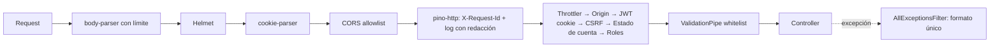

# Arquitectura

Monolito modular NestJS (plan §5–7). Controllers delgados, reglas de negocio en services, acceso a datos con TypeORM, integraciones externas detrás de interfaces en `src/integrations/`. Este documento describe **lo que existe hoy**; el diseño completo está en el plan.

## Estado por etapa

| Etapa                       | Estado                                                                                                                                                                                                   |
| --------------------------- | -------------------------------------------------------------------------------------------------------------------------------------------------------------------------------------------------------- |
| 3. Bootstrap                | Hecha: configuración validada, pipeline HTTP, errores, logger, rate limit, Swagger, health live, Docker, CI                                                                                              |
| 4. Base de datos            | Hecha: TypeORM, migraciones, roles de base, auditoría append-only, catálogos (ubicaciones, oficios, planes), `/health/ready`                                                                             |
| 5. Usuarios y autenticación | Hecha: registro en dos pasos con barrios creados por usuarios, login con cookies, refresh rotativo, CSRF, MFA del admin, reset por admin, guards globales (ver `docs/auth.md` y `docs/authorization.md`) |
| 6. Autorización y estados   | Hecha: suspensión, baneo, restauración, cambio de rol, revocación de sesiones y baja con anonimización (admin y propia); test que recorre todas las rutas                                                |
| 7.1 Archivos e identidad    | Hecha: archivos (Cloudinary/local) y foto de perfil, verificación de identidad (módulo de referencia), moderación de barrios, tareas programadas                                                         |
| 7.2 Perfiles y planes       | Hecha: perfil de cliente y profesional, medios, certificados, redes, horarios, personalización, prueba de 30 días con recordatorios, cambio de foto en revisión                                          |
| 7.3 Catálogo                | Hecha: catálogo público con filtros y orden (ADR 0022), página pública por slug, edición de datos personales (ADR 0021)                                                                                  |
| 7B Login con Google         | Hecha: OpenID Connect con PKCE (adaptador simulado hasta tener credenciales), vinculación con contraseña o email, registro con Google, cuentas sin contraseña                                            |
| 8–13                        | Pendientes (ver `docs/roadmap.md`, incluye la etapa 7B de login con Google)                                                                                                                              |

## Estructura actual

```
src/
├── main.ts                 # crea la app y escucha en PORT
├── app.module.ts           # config, logger, throttler, base de datos, auditoría y providers globales
├── app.setup.ts            # configureApp(): pipeline HTTP compartido por main.ts y los tests e2e
├── config/
│   ├── env.validation.ts   # esquema del entorno (class-validator) y validateEnv()
│   ├── app.config.ts       # namespace tipado `app`
│   ├── database.config.ts  # namespace tipado `database`
│   └── load-env-files.ts   # .env.* para procesos fuera de Nest (CLI, seeds, tests)
├── common/
│   ├── errors/api-error.ts         # formato único de error
│   ├── filters/all-exceptions.filter.ts   # incluye 23505/23503 de PostgreSQL → 409
│   ├── pipes/create-validation-pipe.ts
│   └── logging/logger.options.ts   # pino: redacción y X-Request-Id
├── database/
│   ├── data-source.options.ts  # opciones compartidas (app, CLI, tests) y lista de entidades
│   ├── data-source.ts          # DataSource de la CLI de migraciones
│   ├── database.module.ts      # TypeOrmModule
│   ├── snake-naming.strategy.ts
│   ├── transformers.ts
│   ├── migrations/             # SQL escrito a mano + index.ts con la lista ordenada
│   └── seeds/                  # catálogos maestros idempotentes + CLI
├── common/decorators/      # @Public, @Roles, @AllowAccountStates, @CurrentUser, @SkipCsrf…
├── common/guards/          # Origin, JwtAuth, Csrf, AccountState, Roles (globales)
├── common/crypto/          # tokens aleatorios, SHA-256, HMAC, AES-256-GCM
├── auth/                   # registro, login, MFA, sesiones, CSRF, cookies, reset, CLI admin:create
├── users/                  # entidad, ciclo de vida de la cuenta, purga diaria (cron)
├── professionals/          # perfil, medios, certificados, redes, horarios, tema; moderación de contenido
├── integrations/mail/      # MailProvider + adaptadores consola/memoria
├── integrations/storage/   # StorageProvider + Cloudinary / disco local, detección de tipo real
├── integrations/oauth/     # OAuthProvider + Google (openid-client) / simulado
├── integrations/identity/  # IdentityVerificationProvider + manual / simulado (fake)
├── catalog/                # catálogo público: búsqueda, orden y página del profesional
├── uploads/                # stored_files, tickets de subida, confirmación, foto de perfil, limpieza
├── identity-verification/  # intentos, webhook del proveedor, cola y decisiones del admin
├── audit/                  # AuditService (puerto AUDIT_LOGGER), global
├── locations/              # provincias, localidades, barrios (autocompletado y moderación del admin)
├── professions/            # catálogo público de oficios
├── subscriptions/          # planes, prueba de 30 días, recordatorios y vencimiento (tarea diaria)
└── health/                 # GET /api/v1/health/live y /ready
test/
├── setup/                  # reset de la base de test (globalSetup)
├── utils/                  # app de test y cliente con cookies (auth-client)
├── integration/            # contra PostgreSQL real
└── *.e2e-spec.ts           # app real con Supertest
```

`professions` expone solo lo que necesita el registro; su administración llega con el panel del admin.

## Pipeline de una request



Detalle de cada guard en `docs/authorization.md`. El de suscripción/plan llega en las etapas 7 y 9.

## Decisiones técnicas

**Etapa 3**

- **`configureApp()` compartido:** los tests e2e levantan exactamente el mismo pipeline que producción.
- **Pipe, filtro y guard como providers globales (`APP_*`):** también aplican en los tests sin repetir código.
- **El servidor genera el `X-Request-Id`** y no acepta el que manda el cliente.
- **Errores 5xx sin detalles:** el mensaje y el stack van solo al log.
- **Configuración:** `validateEnv()` es la única fuente de defaults y tipos. `@nestjs/config` 12 solo copia a `process.env` valores escalares, por eso la validación de `ConfigModule` devuelve las variables crudas y los namespaces arman la versión tipada.
- **La app escucha en IPv4 e IPv6** (sin host fijo), así `localhost` funciona aunque resuelva a `::1`.

**Etapa 4**

- **Migraciones en SQL escrito a mano** y registradas en una lista explícita (`migrations/index.ts`), sin globs: funcionan igual en Jest, en la CLI y en la imagen. Un test detecta archivos sin registrar.
- **Nombres de constraints deterministas** (`SnakeNamingStrategy`): permiten el test que compara entidades con el esquema real.
- **Dos roles de base:** la API corre con un rol sin DDL; las migraciones, con el dueño del esquema.
- **Auditoría append-only en la base** (trigger) además de los permisos, para que funcione aunque el proveedor no permita crear roles.
- **`logging: false` en TypeORM** y redacción de `parameters` en el logger: los errores de queries incluyen los valores enviados (emails, hashes).
- **`installExtensions: false`:** TypeORM no intenta crear extensiones al conectarse (el rol de runtime no puede); las crean las migraciones.
- **Seeds idempotentes que no pisan datos:** `ON CONFLICT DO NOTHING` sobre la clave natural.

**Etapa 5**

- **JWT corto + sesión en base:** el guard valida la firma y además que la sesión `sid` siga viva; rol y
  estado se leen de la base en cada request (revocación efectiva en la request siguiente).
- **Una fila por refresh token** (`auth_sessions`); la familia es el dispositivo. Rotación atómica con
  `SELECT … FOR UPDATE`; la detección de reutilización y su auditoría se confirman antes de responder 401.
- **CSRF ligado a la familia** (no al `sid`): no cambia en cada refresh. En el refresh, un token ya
  rotado se procesa antes de exigir CSRF, para que un refresh robado igual dispare la revocación.
- **Rotación del secreto JWT** con `kid` en el header (secreto actual y anterior).
- **Emails por eventos después del commit** (`@nestjs/event-emitter` + `emitAsync`): no se manda un
  email por algo revertido, y los tests leen el buzón en memoria de forma determinista.
- **`import type` en firmas decoradas:** con `isolatedModules` + `emitDecoratorMetadata`, los tipos
  usados en constructores con `@Inject` se importan como tipo.
- **Barrios por "buscar o crear"** con `INSERT … ON CONFLICT DO NOTHING` (sin carreras) dentro de la
  transacción del registro.

**Etapa 6**

- **`AccountsService` (módulo `users`)** concentra el ciclo de vida: cada acción bloquea la fila del
  usuario (`FOR UPDATE`), valida la transición, revoca sesiones y audita en una sola transacción.
- **`ProfessionalsService`** (alta, reactivación y desactivación del perfil, zonas de trabajo) lo usan
  el registro y el cambio de rol: una sola implementación de las reglas de la ADR 0010.
- **Sin tabla `role_changes`**: el historial de roles vive en la auditoría (`ROLE_CHANGED`).
- **Test de todas las rutas**: lee las rutas registradas en Express y exige 401 sin sesión salvo una
  lista explícita de públicas.

**Etapa 7.1**

- **Subida directa al proveedor:** el binario no pasa por la API (con Cloudinary). La API emite un
  ticket firmado y, al confirmar, consulta al proveedor el tipo, el peso y la duración reales. El
  adaptador local imita el flujo con `PUT /uploads/:id/content` y detecta el tipo por magic bytes.
- **Actualizaciones condicionales** (`WHERE status = 'PENDING_UPLOAD'`) en vez de locks largos: la
  consulta al proveedor queda fuera de las transacciones.
- **Verificación de identidad portada** de `docs/referencia/verificacion-identidad`: misma máquina de
  estados e idempotencia; usa la auditoría, la configuración y las sesiones del proyecto. Exige email
  verificado y foto (ADR 0006); al revocar cierra las sesiones en la misma transacción.
- **`rawBody: true`** en la app: el webhook valida la firma sobre los bytes exactos.
- **Tareas programadas** con `@nestjs/schedule` (apagadas en tests) y un lock de PostgreSQL
  (`pg_try_advisory_lock`) para que dos instancias, o el comando manual, no corran a la vez.

**Etapa 7.2**

- **Límites desde el plan vigente:** `SubscriptionsService.livePlan` es la única fuente (prueba = Basic,
  ADR 0017). Sin plan vigente se puede editar el texto del perfil, pero no sumar contenido.
- **Cada cambio de contenido bloquea el perfil** (`FOR UPDATE`): dos pestañas no pueden superar un límite.
- **Estado de atención calculado al leerlo** (manual, vencimiento, horario y excepciones en hora de
  Córdoba): no hace falta una tarea que lo actualice cada pocos minutos.
- **Personalización con listas cerradas** validadas contra el `theme_level` del plan: nunca CSS ni
  HTML del usuario.
- **Cambio de foto con identidad aprobada** (ADR 0019) dentro de `IdentityVerificationService`: la
  revisión es un intento `AVATAR_CHANGE` y "identidad aprobada" incluye ese caso (`isIdentityApproved`).
- **Módulos sin ciclos:** `subscriptions` no importa a nadie del dominio; `uploads` usa
  `subscriptions`; `professionals` usa `uploads` y `subscriptions`.

**Etapa 7.3**

- **Visibilidad calculada en cada consulta** (sin `is_listed`): una sola condición SQL (`VISIBLE` en
  `catalog.service.ts`) con cuenta, identidad, prueba o plan vigente y perfil completo.
- **Estado de atención en SQL** para filtrar "Disponible ya" y ordenar; es la misma regla que
  `effectiveAttentionStatus` y un test e2e compara los dos resultados.
- **Lo que excede el plan actual no se muestra** en la página pública (tema, banner, cantidad de
  medios), sin borrar nada: al volver a subir de plan reaparece.
- **Email y teléfono solo en el detalle**, con un límite de 30 consultas por minuto por IP (C-19).
- **Revisión de datos única** (`PROFILE_CHANGE`): foto y nombre pendientes se aprueban o rechazan juntos.

**Etapa 7B**

- **OpenID Connect con `openid-client`** detrás de `OAuthProvider`; el servicio solo ve un perfil
  (sub, email verificado, nombre). State, nonce y verificador PKCE viajan en una cookie cifrada
  (AES-256-GCM) de 10 minutos; la URL del callback sale de la configuración, nunca del header `Host`.
- **`SessionResponderService`**: un solo lugar entrega las cookies de sesión (login, MFA y Google).
- **La vinculación nunca es automática**: el pedido pendiente guarda solo hashes de tokens y vence a
  los 30 minutos; vincular con contraseña usa el mismo bloqueo progresivo que el login.
