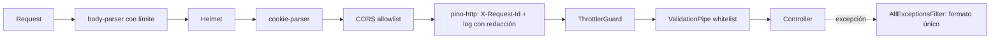

# Arquitectura

Monolito modular NestJS (plan §5–7). Controllers delgados, reglas de negocio en services, acceso a datos con TypeORM, integraciones externas detrás de interfaces en `src/integrations/`. Este documento describe **lo que existe hoy**; el diseño completo está en el plan.

## Estado por etapa

| Etapa                       | Estado                                                                                                                       |
| --------------------------- | ---------------------------------------------------------------------------------------------------------------------------- |
| 3. Bootstrap                | Hecha: configuración validada, pipeline HTTP, errores, logger, rate limit, Swagger, health live, Docker, CI                  |
| 4. Base de datos            | Hecha: TypeORM, migraciones, roles de base, auditoría append-only, catálogos (ubicaciones, oficios, planes), `/health/ready` |
| 5. Usuarios y autenticación | Pendiente                                                                                                                    |

## Estructura actual

```
src/
├── main.ts                 # crea la app y escucha en PORT
├── app.module.ts           # config, logger, throttler, base de datos, auditoría y providers globales
├── app.setup.ts            # configureApp(): pipeline HTTP compartido por main.ts y los tests e2e
├── config/
│   ├── env.validation.ts   # esquema del entorno (class-validator) y validateEnv()
│   ├── app.config.ts       # namespace tipado `app`
│   ├── database.config.ts  # namespace tipado `database`
│   └── load-env-files.ts   # .env.* para procesos fuera de Nest (CLI, seeds, tests)
├── common/
│   ├── errors/api-error.ts         # formato único de error
│   ├── filters/all-exceptions.filter.ts   # incluye 23505/23503 de PostgreSQL → 409
│   ├── pipes/create-validation-pipe.ts
│   └── logging/logger.options.ts   # pino: redacción y X-Request-Id
├── database/
│   ├── data-source.options.ts  # opciones compartidas (app, CLI, tests) y lista de entidades
│   ├── data-source.ts          # DataSource de la CLI de migraciones
│   ├── database.module.ts      # TypeOrmModule
│   ├── snake-naming.strategy.ts
│   ├── transformers.ts
│   ├── migrations/             # SQL escrito a mano + index.ts con la lista ordenada
│   └── seeds/                  # catálogos maestros idempotentes + CLI
├── audit/                  # AuditService (puerto AUDIT_LOGGER), global
├── locations/entities/     # provincias, localidades, barrios
├── professions/entities/
├── subscriptions/entities/ # planes
└── health/                 # GET /api/v1/health/live y /ready
test/
├── setup/                  # reset de la base de test (globalSetup)
├── integration/            # contra PostgreSQL real
└── *.e2e-spec.ts           # app real con Supertest
```

Los módulos de catálogo (`locations`, `professions`, `subscriptions`) por ahora solo tienen entidades. Sus endpoints llegan en la etapa 7.

## Pipeline de una request



Las etapas 5 y 6 agregan, después del throttler y en este orden: `OriginGuard` → `JwtCookieAuthGuard` → `CsrfGuard` → `AccountStateGuard` → `RolesGuard` → `SubscriptionGuard`.

## Decisiones técnicas

**Etapa 3**

- **`configureApp()` compartido:** los tests e2e levantan exactamente el mismo pipeline que producción.
- **Pipe, filtro y guard como providers globales (`APP_*`):** también aplican en los tests sin repetir código.
- **El servidor genera el `X-Request-Id`** y no acepta el que manda el cliente.
- **Errores 5xx sin detalles:** el mensaje y el stack van solo al log.
- **Configuración:** `validateEnv()` es la única fuente de defaults y tipos. `@nestjs/config` 12 solo copia a `process.env` valores escalares, por eso la validación de `ConfigModule` devuelve las variables crudas y los namespaces arman la versión tipada.
- **La app escucha en IPv4 e IPv6** (sin host fijo), así `localhost` funciona aunque resuelva a `::1`.

**Etapa 4**

- **Migraciones en SQL escrito a mano** y registradas en una lista explícita (`migrations/index.ts`), sin globs: funcionan igual en Jest, en la CLI y en la imagen. Un test detecta archivos sin registrar.
- **Nombres de constraints deterministas** (`SnakeNamingStrategy`): permiten el test que compara entidades con el esquema real.
- **Dos roles de base:** la API corre con un rol sin DDL; las migraciones, con el dueño del esquema.
- **Auditoría append-only en la base** (trigger) además de los permisos, para que funcione aunque el proveedor no permita crear roles.
- **`logging: false` en TypeORM** y redacción de `parameters` en el logger: los errores de queries incluyen los valores enviados (emails, hashes).
- **`installExtensions: false`:** TypeORM no intenta crear extensiones al conectarse (el rol de runtime no puede); las crean las migraciones.
- **Seeds idempotentes que no pisan datos:** `ON CONFLICT DO NOTHING` sobre la clave natural.
