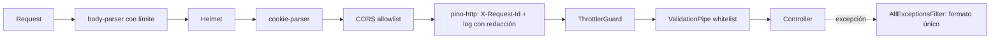

# Arquitectura

Monolito modular NestJS (plan §5–7). Controllers delgados, reglas de negocio en services, acceso a datos con TypeORM, integraciones externas detrás de interfaces en `src/integrations/`. Este documento describe **lo que existe hoy**; el diseño completo está en el plan.

## Estado por etapa

| Etapa            | Estado                                                                                                      |
| ---------------- | ----------------------------------------------------------------------------------------------------------- |
| 3. Bootstrap     | Hecha: configuración validada, pipeline HTTP, errores, logger, rate limit, Swagger, health live, Docker, CI |
| 4. Base de datos | Pendiente (agrega TypeORM, migraciones y `/health/ready`)                                                   |

## Estructura actual

```
src/
├── main.ts                 # crea la app y escucha en PORT
├── app.module.ts           # config, logger, throttler y providers globales (guard, pipe, filtro)
├── app.setup.ts            # configureApp(): pipeline HTTP compartido por main.ts y los tests e2e
├── config/
│   ├── env.validation.ts   # esquema del entorno (class-validator) y validateEnv()
│   └── app.config.ts       # namespace tipado `app`
├── common/
│   ├── errors/api-error.ts         # formato único de error
│   ├── filters/all-exceptions.filter.ts
│   ├── pipes/create-validation-pipe.ts
│   └── logging/logger.options.ts   # pino: redacción y X-Request-Id
└── health/                 # GET /api/v1/health/live
test/                       # e2e con Supertest sobre la app real
```

## Pipeline de una request



Las etapas 5 y 6 agregan, después del throttler y en este orden: `OriginGuard` → `JwtCookieAuthGuard` → `CsrfGuard` → `AccountStateGuard` → `RolesGuard` → `SubscriptionGuard`.

## Decisiones de la etapa 3

- **`configureApp()` compartido:** los tests e2e levantan exactamente el mismo pipeline que producción.
- **Pipe, filtro y guard como providers globales (`APP_*`)** en lugar de `app.useGlobal*`: así también aplican en los tests sin repetir código.
- **El servidor genera el `X-Request-Id`** y no acepta el que manda el cliente, para que no se pueda falsear la trazabilidad.
- **Errores 5xx sin detalles:** el mensaje y el stack van solo al log. Los errores de body-parser (413, JSON inválido) también salen con el formato único.
- **Configuración:** `validateEnv()` es la única fuente de defaults y tipos. `@nestjs/config` 12 solo copia a `process.env` valores escalares, por eso la validación de `ConfigModule` devuelve las variables crudas y `appConfig` arma la versión tipada.
- **Swagger** solo si `SWAGGER_ENABLED=true` y fuera de producción, en `/api/docs`.
