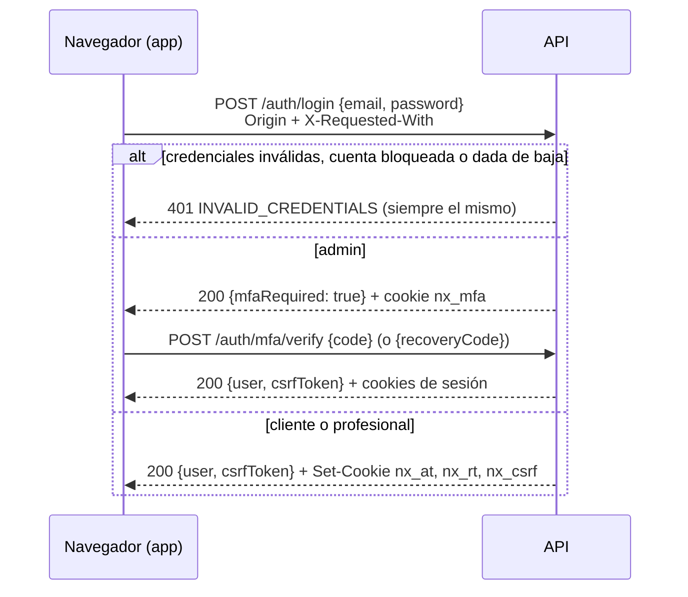
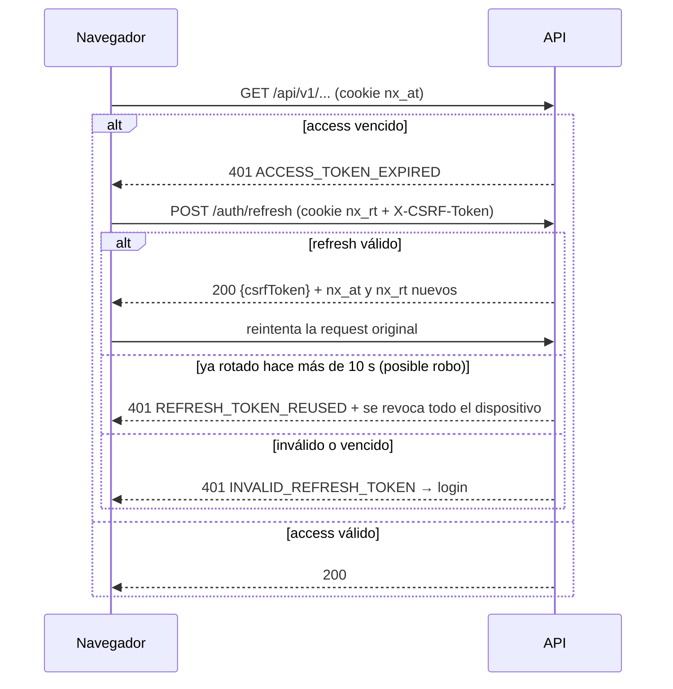

# Autenticación con cookies

Diseño: plan §9, ADR 0001, 0002, 0005, 0007 y 0008. Este documento describe **lo implementado** y cómo
lo integra el frontend Next.js.

## Resumen

- **Access token**: JWT HS256 de 10 min (5 min el admin) con solo `sub`, `sid`, `iat`, `exp`, `iss`,
  `aud` (y `kid` en el header). Va en una cookie `HttpOnly`.
- **Refresh token**: 256 bits aleatorios, opaco, en otra cookie `HttpOnly` con `Path=/api/v1/auth`.
  En la base solo está su SHA-256 (`auth_sessions`). Se **rota en cada uso**.
- **Cada request** valida firma, `iss`, `aud` y `exp` (algoritmo fijo) y además que la sesión `sid`
  siga viva; el rol y el estado se leen de la base. Una suspensión o un logout rigen en la request
  siguiente, no cuando vence el token.
- **Ningún token viaja en el body** de ninguna respuesta, ni se loguea.

## Cookies

| Cookie (local) | Cookie (producción) | Contenido                           | Path               | Max-Age                                     |
| -------------- | ------------------- | ----------------------------------- | ------------------ | ------------------------------------------- |
| `nx_at`        | `__Host-nx_at`      | Access JWT                          | `/`                | 10 min (admin 5)                            |
| `nx_rt`        | `__Secure-nx_rt`    | Refresh opaco                       | `/api/v1/auth`     | Inactividad: 14 días (admin 12 h)           |
| `nx_csrf`      | `__Host-nx_csrf`    | Valor aleatorio del CSRF            | `/`                | Vida máxima de la sesión: 30 días (admin 7) |
| `nx_mfa`       | `__Secure-nx_mfa`   | Paso intermedio del login del admin | `/api/v1/auth/mfa` | 5 min                                       |

Todas: `HttpOnly`, `SameSite=Lax`, **sin `Domain`** (solo las recibe `api.<dominio>`), `Secure` en
producción (`COOKIE_SECURE=true`, obligatorio). Se borran con exactamente los mismos atributos. Los
nombres y atributos salen solo de `src/config/auth.config.ts` y `AuthCookiesService`.

| Ambiente   | Frontend                | API                     | ¿Same-site?                    | Cookies                                  |
| ---------- | ----------------------- | ----------------------- | ------------------------------ | ---------------------------------------- |
| Local      | `http://localhost:3000` | `http://localhost:3001` | Sí (el puerto no cuenta)       | Sin prefijo, sin `Secure`                |
| Producción | `https://app.<dominio>` | `https://api.<dominio>` | Sí (mismo dominio registrable) | Prefijos `__Host-`/`__Secure-`, `Secure` |

En local usá siempre `localhost` (no `127.0.0.1`): son sitios distintos para el navegador.
Consecuencia de las cookies host-only: el **servidor** de Next.js no ve la sesión. Las páginas privadas
cargan sus datos desde el navegador; las públicas (catálogo, foro) pueden renderizarse en el servidor.

## Flujos

### Registro (ADR 0006 y 0010)

`POST /api/v1/auth/register` → `202` con un mensaje **genérico**, exista o no el email (si existe, al
dueño le llega un aviso). La cuenta queda `PENDING_VERIFICATION` y llega un email de verificación
(24 h). No inicia sesión.

- Cliente: `neighborhood: { localityId, name }` (barrio donde vive).
- Profesional: `professionId` y `serviceAreas: [{ localityId, neighborhoodName? }]` (1 a 20; sin
  `neighborhoodName` = toda la localidad).
- Los barrios se escriben libremente; si no existen se crean `PENDING` (ver ADR 0010).

### Login



- Bloqueo progresivo **por cuenta** (5 fallos → 1 min, 10 → 15 min, 15 → 1 h; nunca permanente) más
  **5 intentos por minuto por IP**. Los códigos TOTP fallidos suman al mismo bloqueo.
- Un código TOTP no se puede usar dos veces; cada código de recuperación, una sola vez.
- Cuentas `SUSPENDED`/`BANNED` inician sesión pero solo pueden ver `/auth/me`, sus sesiones y cerrar
  sesión (ADR 0007). `DEACTIVATED` no puede iniciar sesión.

### Request autenticada y renovación



- **Ventana de gracia**: si dos pestañas refrescan a la vez, la segunda presenta el refresh que la
  primera acaba de rotar. Dentro de los 10 s siguientes no se considera robo: recibe un access nuevo y
  conserva el refresh que ya tiene el navegador.
- La vida máxima de la sesión (30 días, admin 7) no se extiende con las rotaciones.

### Logout y sesiones

| Acción           | Endpoint                    | Efecto                                                          |
| ---------------- | --------------------------- | --------------------------------------------------------------- |
| Logout           | `POST /auth/logout`         | Revoca el dispositivo actual y borra las cookies. Siempre `204` |
| Cerrar todo      | `POST /auth/logout-all`     | Revoca todas las sesiones del usuario                           |
| Ver dispositivos | `GET /auth/sessions`        | Lista con `current: true` en el actual                          |
| Cerrar uno       | `DELETE /auth/sessions/:id` | Solo propios (404 si no)                                        |

También se revocan sesiones al restablecer la contraseña (todas), al cambiarla (todas menos la actual)
y al detectar reutilización de un refresh. Las de cambio de rol, suspensión y baja llegan en la etapa 6.

### Email y contraseña

| Flujo                               | Endpoints                                                                                                          | Notas                                                                                                                          |
| ----------------------------------- | ------------------------------------------------------------------------------------------------------------------ | ------------------------------------------------------------------------------------------------------------------------------ |
| Verificar email                     | `POST /auth/email/verify {token}` · `POST /auth/email/resend`                                                      | Token de un solo uso, 24 h                                                                                                     |
| Recuperar contraseña (ADR 0002)     | `POST /admin/users/:id/password-reset {reason}` (admin) → email → `POST /auth/password/reset {token, newPassword}` | El admin nunca ve la contraseña ni el token. Enlace de 30 min, un solo uso. Cierra **todas** las sesiones. Auditado con motivo |
| Olvidé mi contraseña (autoservicio) | `POST /auth/password/forgot`                                                                                       | Implementado pero **apagado** (`PASSWORD_SELF_RESET_ENABLED=false` → 404)                                                      |
| Cambiar contraseña                  | `POST /auth/password/change {currentPassword, newPassword}`                                                        | Exige la actual                                                                                                                |

Contraseñas (ADR 0011): 8 a 128 caracteres (admin: mínimo 12), distinta del email, sin reglas de
composición. Hash argon2id.

Enlaces de los emails (se arman con `FRONTEND_URL`, nunca con el header `Host`):
`<FRONTEND_URL>/verificar-email?token=…` y `<FRONTEND_URL>/restablecer-contrasena?token=…`.
El frontend toma el `token` de la URL y lo manda al endpoint correspondiente.

## CSRF (defensa en capas)

1. `SameSite=Lax`: el navegador no manda las cookies en POST iniciados desde otro sitio.
2. Ningún `GET` modifica datos.
3. `OriginGuard`: en métodos no seguros, `Origin` (o el origen del `Referer`) debe estar en
   `FRONTEND_ORIGINS` y es obligatorio `X-Requested-With: XMLHttpRequest`.
4. **Token CSRF firmado** en métodos no seguros con sesión: `HMAC(CSRF_SECRET, dispositivo + valor de
la cookie nx_csrf)`. Llega en el body del login, del refresh y de `GET /auth/csrf`. El frontend lo
   guarda **en memoria** y lo manda en `X-CSRF-Token`. Está ligado al dispositivo (no cambia en cada
   refresh) y no sirve para otra sesión.
5. Login, registro y verificación de email (sin sesión) quedan protegidos por 1–3 y el rate limit.

`HttpOnly` no impide CSRF ni XSS: un script inyectado no lee las cookies, pero puede hacer requests
desde la página. La defensa contra XSS es aparte (texto plano, escape en React, CSP en Next.js).

## CORS

Allowlist exacta desde `FRONTEND_ORIGINS` (nunca `*` ni reflejar el `Origin`), `credentials: true`,
headers permitidos `Content-Type`, `X-Requested-With`, `X-CSRF-Token`; expone `X-Request-Id`.

## Guía para el frontend (Next.js)

```ts
// lib/api.ts — cliente único del navegador
const API = process.env.NEXT_PUBLIC_API_URL!; // http://localhost:3001/api/v1 | https://api.<dominio>/api/v1
let csrfToken: string | null = null; // SOLO en memoria: nunca localStorage/sessionStorage
let refreshing: Promise<boolean> | null = null;

export function setCsrfToken(token: string) {
  csrfToken = token;
}

async function raw(path: string, init: RequestInit = {}) {
  const method = (init.method ?? 'GET').toUpperCase();
  const headers = new Headers(init.headers);
  headers.set('X-Requested-With', 'XMLHttpRequest');
  if (init.body && !headers.has('Content-Type')) headers.set('Content-Type', 'application/json');
  if (!['GET', 'HEAD'].includes(method) && csrfToken) headers.set('X-CSRF-Token', csrfToken);
  return fetch(`${API}${path}`, { ...init, headers, credentials: 'include' });
}

/** Un solo refresh compartido entre todas las requests que reciban 401 a la vez. */
function refreshOnce(): Promise<boolean> {
  refreshing ??= (async () => {
    if (!csrfToken) await loadCsrf();
    const res = await raw('/auth/refresh', { method: 'POST' });
    if (res.ok) setCsrfToken((await res.json()).csrfToken);
    return res.ok;
  })().finally(() => (refreshing = null));
  return refreshing;
}

/** Tras recargar la página el token se perdió: se pide de nuevo (usa la cookie de refresh). */
export async function loadCsrf(): Promise<void> {
  const res = await raw('/auth/csrf');
  if (res.ok) setCsrfToken((await res.json()).csrfToken);
}

export async function api<T>(path: string, init?: RequestInit): Promise<T> {
  let res = await raw(path, init);
  if (res.status === 401) {
    const { code } = await res
      .clone()
      .json()
      .catch(() => ({ code: null }));
    if (code === 'ACCESS_TOKEN_EXPIRED' && (await refreshOnce())) res = await raw(path, init);
  }
  if (res.status === 401) {
    // Sesión terminada: limpiar estado y caché, y redirigir al login con router.replace.
    throw new Error('UNAUTHORIZED');
  }
  if (!res.ok) throw await res.json(); // { statusCode, code, message, details, requestId }
  return res.status === 204 ? (undefined as T) : res.json();
}
```

- Login: `POST /auth/login` → si la respuesta trae `csrfToken`, `setCsrfToken(...)`; si trae
  `mfaRequired`, mostrar el paso del código y llamar a `POST /auth/mfa/verify`.
- Al iniciar la app (o recargar): `loadCsrf()` y `GET /auth/me` para saber quién está logueado.
- Logout: `POST /auth/logout`, borrar `csrfToken`, limpiar caché (React Query/SWR) y
  `router.replace('/login')`.
- Nunca leer ni escribir las cookies desde JavaScript (no se puede: son `HttpOnly`).
- El middleware de Next.js no es seguridad: no ve las cookies de la API. Toda autorización la hace el
  backend.

## Admin inicial

```bash
npm run admin:create -- --email admin@<dominio> --first-name … --last-name … --phone …
```

Crea el único admin (`ACTIVE`, email verificado) con contraseña aleatoria y segundo factor TOTP. La
contraseña, el secreto TOTP (con URI `otpauth://` para el QR) y 10 códigos de recuperación se
muestran **una sola vez** en la terminal: no quedan en logs ni archivos; en la base, solo el hash y el
secreto cifrado (AES-256-GCM con `DATA_ENCRYPTION_KEY`). Se niega a correr si ya existe un admin.
Cambiá la contraseña después del primer login.

## Qué falta (ver `docs/decisions/pendientes.md`)

CAPTCHA tras varios fallos, chequeo de contraseñas filtradas, cambio de email, Google OAuth (etapa 13),
rotación/reenrolamiento del TOTP del admin, job de limpieza de sesiones vencidas y proveedor real de
email (sin él la API no arranca en producción).
