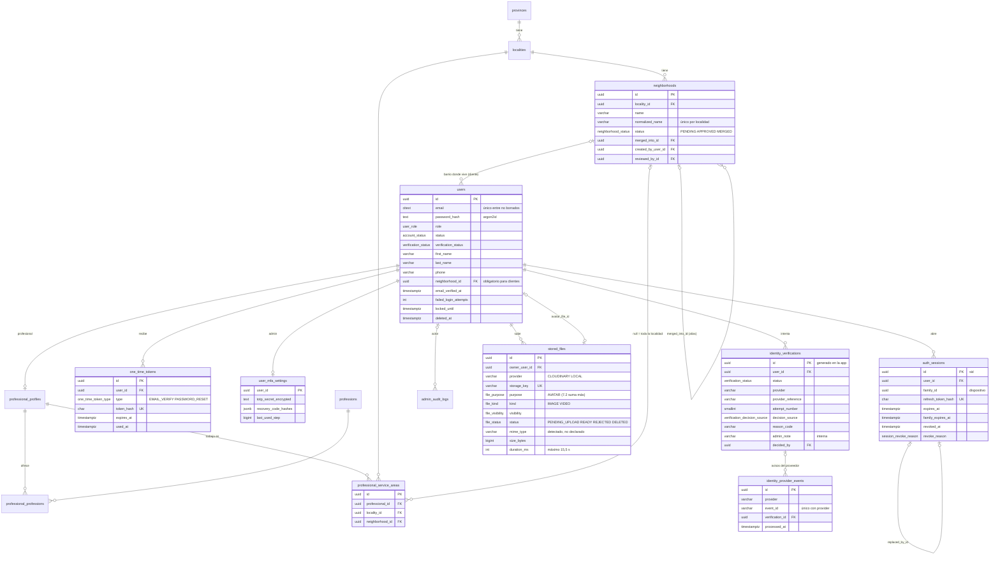

# Modelo de datos

Describe las tablas **que existen hoy**. El modelo completo propuesto está en el plan (§8); cada etapa
agrega su parte y la documenta acá.

## Convenciones

| Tema            | Regla                                                                                                                                                                                                 |
| --------------- | ----------------------------------------------------------------------------------------------------------------------------------------------------------------------------------------------------- |
| Esquema         | Solo cambia con migraciones escritas y revisadas a mano (`src/database/migrations/`). `synchronize: false` siempre                                                                                    |
| Nombres         | Tablas y columnas en `snake_case`. Constraints con nombre fijo: `pk_<tabla>`, `fk_<tabla>_<columnas>`, `uq_…`, `ix_…`, `ck_…` (`SnakeNamingStrategy`)                                                 |
| Ids             | `uuid` con `gen_random_uuid()` (nativo de PostgreSQL)                                                                                                                                                 |
| Fechas          | `timestamptz`, en UTC                                                                                                                                                                                 |
| Dinero          | `numeric(12,2)` + `currency char(3)`; en TypeScript es `string` para no perder precisión                                                                                                              |
| Únicos de texto | Sin distinguir mayúsculas (`lower(name)` o `citext`); barrios por nombre normalizado                                                                                                                  |
| Borrado         | Catálogos: `active = false`. Usuarios: soft delete (`deleted_at`) con anonimización (ADR 0013). Perfil profesional: `deactivated_at`. FK `RESTRICT` salvo sesiones y tokens (`CASCADE`, descartables) |
| Secretos        | Contraseñas con argon2id; refresh y enlaces de un solo uso: solo SHA-256; secreto TOTP cifrado (AES-256-GCM). **Sin DNI** (ADR 0006)                                                                  |

Un test de integración compara las entidades con el esquema real que dejan las migraciones; si alguien
cambia una entidad sin migración (o al revés), falla.

## Diagrama (etapas 4 a 7.1)

Las tablas de la etapa 4 (`provinces`, `localities`, `professions`, `subscription_plans`,
`admin_audit_logs`) mantienen las columnas descritas abajo.

## Tablas

| Tabla                        | Para qué                                                                                                               | Integridad en la base                                                                                                           |
| ---------------------------- | ---------------------------------------------------------------------------------------------------------------------- | ------------------------------------------------------------------------------------------------------------------------------- |
| `provinces`, `localities`    | Ubicaciones que habilita el admin                                                                                      | Únicos por nombre sin mayúsculas; FK `RESTRICT`; coordenadas ambas o ninguna, en rango                                          |
| `neighborhoods`              | Barrios creados por los usuarios (ADR 0010)                                                                            | Nombre normalizado único por localidad (incluye alias fusionados); `merged_into_id` si y solo si `MERGED`; no apunta a sí mismo |
| `professions`                | Catálogo único de oficios (lo administra el admin)                                                                     | `slug` único con formato `minúsculas-con-guiones`; nombre único sin mayúsculas                                                  |
| `subscription_plans`         | **Única fuente** de precios y límites de plan                                                                          | `code` único; precio ≥ 0; moneda de 3 letras mayúsculas; límites no negativos y al menos 1 profesión                            |
| `users`                      | Identidad y credenciales                                                                                               | Email único entre no borrados (`citext`); intentos fallidos ≥ 0; un cliente tiene barrio                                        |
| `auth_sessions`              | Una fila por refresh token; la familia es el dispositivo                                                               | Hash único; `replaced_by_id` encadena las rotaciones                                                                            |
| `one_time_tokens`            | Enlaces de un solo uso                                                                                                 | Hash único; el consumo es un `UPDATE … WHERE used_at IS NULL AND expires_at > now()` atómico                                    |
| `user_mfa_settings`          | TOTP del admin                                                                                                         | Uno por usuario                                                                                                                 |
| `professional_profiles`      | Perfil profesional (mínimo hasta la etapa 7). `deactivated_at` si el usuario cambió de rol o se dio de baja (ADR 0012) | Uno por usuario                                                                                                                 |
| `professional_professions`   | Oficios del profesional                                                                                                | Una sola principal por profesional (índice parcial)                                                                             |
| `professional_service_areas` | Zonas de trabajo (1 a 20)                                                                                              | El barrio pertenece a la localidad (FK compuesta); sin zonas repetidas (`NULLS NOT DISTINCT`)                                   |
| `stored_files`               | Metadatos de archivos (ADR 0018); el binario está en Cloudinary (o en disco en desarrollo)                             | `storage_key` único; READY exige tipo y peso; duración ≤ 15,5 s; índice parcial de pendientes para la limpieza                  |
| `identity_verifications`     | Intentos de verificación de identidad (ADR 0003). Sin imágenes ni datos biométricos                                    | Un solo intento abierto por usuario (índice único parcial); `(user_id, attempt_number)` único; referencia del proveedor única   |
| `identity_provider_events`   | Webhooks recibidos del proveedor                                                                                       | `(provider, event_id)` único: idempotencia                                                                                      |
| `admin_audit_logs`           | Acciones administrativas y eventos de seguridad                                                                        | **Append-only**: un trigger rechaza `UPDATE`, `DELETE` y `TRUNCATE`; el rol de runtime solo tiene `SELECT` e `INSERT`           |

Eventos auditados hoy: `USER_REGISTERED`, `ACCOUNT_LOCKED`, `REFRESH_TOKEN_REUSE`, `ADMIN_LOGIN`,
`ADMIN_LOGIN_RECOVERY_CODE`, `ADMIN_PASSWORD_RESET_REQUESTED`, `PASSWORD_RESET_COMPLETED`,
`PASSWORD_CHANGED`, `ADMIN_CREATED`, `ACCOUNT_SUSPENDED`, `ACCOUNT_BANNED`, `ACCOUNT_RESTORED`,
`ROLE_CHANGED` (con rol de origen y destino: reemplaza a la tabla `role_changes` del plan),
`SESSIONS_REVOKED`, `ACCOUNT_DELETION_SCHEDULED`, `ACCOUNT_ANONYMIZED`,
`IDENTITY_VERIFICATION_APPROVE` / `_REJECT` / `_REVOKE` (también los intentos denegados, con
resultado `DENIED`), `NEIGHBORHOOD_APPROVED`, `NEIGHBORHOOD_RENAMED` y `NEIGHBORHOOD_MERGED` (con
cuántos clientes y zonas se movieron).

`users.avatar_file_id`: foto de perfil (paso 2 del registro, ADR 0006). Al anonimizar una cuenta, sus
archivos pasan a `DELETED` y se borran del proveedor.

`users.deletion_scheduled_for`: fecha en que se anonimiza una cuenta dada de baja (30 días de gracia, ADR 0016).

`users.status_reason` guarda el motivo de una suspensión o baneo para mostrárselo al usuario
(ADR 0007); en la etapa 11 lo complementan las sanciones. Las cuentas dadas de baja pueden quedar sin
barrio aunque sean clientes (`ck_users_customer_neighborhood` lo contempla).

## Datos iniciales (`npm run seed:catalogs`)

Idempotente (`ON CONFLICT DO NOTHING`): no duplica y **no pisa** cambios del admin.

| Catálogo    | Contenido                                                                       | Estado                                                          |
| ----------- | ------------------------------------------------------------------------------- | --------------------------------------------------------------- |
| Ubicaciones | Córdoba → Córdoba (capital). **Sin barrios**: los crean los usuarios (ADR 0010) | Sin coordenadas. Faltan las demás localidades                   |
| Oficios     | 10 oficios comunes                                                              | **De ejemplo**; el catálogo final lo define el admin            |
| Planes      | Basic $10.000 · Medium $15.000 · Premium $20.000 (ARS, impuestos incluidos)     | Precios de referencia a confirmar. Límites en la tabla de abajo |

| Límite                   | Basic  | Medium             | Premium                |
| ------------------------ | ------ | ------------------ | ---------------------- |
| Profesiones              | 1      | 2                  | 3                      |
| Imágenes                 | 5      | 5                  | 5                      |
| Videos (máx. 15 s)       | 0      | 1                  | 2                      |
| Personalización          | `NONE` | `STANDARD`         | `EXTENDED`             |
| Ranking (`ranking_tier`) | 0      | 1                  | 2                      |
| Avisos de disponibilidad | No     | Sí                 | Sí, con mensaje propio |
| Métricas                 | No     | No (sin confirmar) | Sí                     |
| Chatbot                  | No     | No                 | Sí                     |

## Roles de base de datos

| Rol                           | Uso                                                             | Permisos                                                                                                        |
| ----------------------------- | --------------------------------------------------------------- | --------------------------------------------------------------------------------------------------------------- |
| Dueño (`nexo` en local)       | Migraciones, seeds y `admin:create` (`DATABASE_MIGRATIONS_URL`) | DDL sobre el esquema                                                                                            |
| Runtime (`nexo_app` en local) | La API (`DATABASE_URL`)                                         | `SELECT/INSERT/UPDATE/DELETE` sobre las tablas; nada de DDL ni `TRUNCATE`; solo `SELECT/INSERT` en la auditoría |

En local los crea `docker/postgres/init/`. En Railway hay que crear el rol de runtime a mano si el plan
lo permite (ver `docs/env.md`); aunque no se pueda, el trigger mantiene la auditoría append-only.
