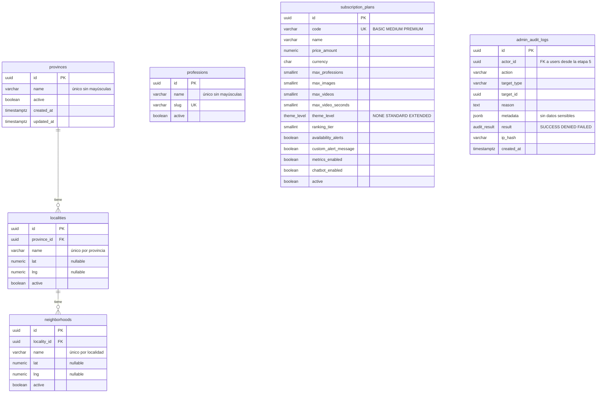

# Modelo de datos

Describe las tablas **que existen hoy**. El modelo completo propuesto está en el plan (§8); cada etapa
agrega su parte y la documenta acá.

## Convenciones

| Tema            | Regla                                                                                                                                                 |
| --------------- | ----------------------------------------------------------------------------------------------------------------------------------------------------- |
| Esquema         | Solo cambia con migraciones escritas y revisadas a mano (`src/database/migrations/`). `synchronize: false` siempre                                    |
| Nombres         | Tablas y columnas en `snake_case`. Constraints con nombre fijo: `pk_<tabla>`, `fk_<tabla>_<columnas>`, `uq_…`, `ix_…`, `ck_…` (`SnakeNamingStrategy`) |
| Ids             | `uuid` con `gen_random_uuid()` (nativo de PostgreSQL)                                                                                                 |
| Fechas          | `timestamptz`, en UTC                                                                                                                                 |
| Dinero          | `numeric(12,2)` + `currency char(3)`; en TypeScript es `string` para no perder precisión                                                              |
| Únicos de texto | Sin distinguir mayúsculas: índice único sobre `lower(name)`                                                                                           |
| Borrado         | Los catálogos no se borran: se desactivan con `active = false` (las FK son `ON DELETE RESTRICT`)                                                      |

Un test de integración compara las entidades con el esquema real que dejan las migraciones; si alguien
cambia una entidad sin migración (o al revés), falla.

## Diagrama (etapa 4)

## Tablas

| Tabla                                      | Para qué                                             | Integridad en la base                                                                                                 |
| ------------------------------------------ | ---------------------------------------------------- | --------------------------------------------------------------------------------------------------------------------- |
| `provinces`, `localities`, `neighborhoods` | Ubicación declarada de usuarios y zonas de cobertura | Únicos por nombre sin mayúsculas dentro del padre; FK `RESTRICT`; coordenadas ambas o ninguna, en rango               |
| `professions`                              | Catálogo único de oficios (lo administra el admin)   | `slug` único con formato `minúsculas-con-guiones`; nombre único sin mayúsculas                                        |
| `subscription_plans`                       | **Única fuente** de precios y límites de plan        | `code` único; precio ≥ 0; moneda de 3 letras mayúsculas; límites no negativos y al menos 1 profesión                  |
| `admin_audit_logs`                         | Acciones administrativas y eventos de seguridad      | **Append-only**: un trigger rechaza `UPDATE`, `DELETE` y `TRUNCATE`; el rol de runtime solo tiene `SELECT` e `INSERT` |

## Datos iniciales (`npm run seed:catalogs`)

Idempotente (`ON CONFLICT DO NOTHING`): no duplica y **no pisa** cambios del admin.

| Catálogo    | Contenido                                                                   | Estado                                                          |
| ----------- | --------------------------------------------------------------------------- | --------------------------------------------------------------- |
| Ubicaciones | Córdoba → Córdoba (capital) → 8 barrios                                     | **De ejemplo**, sin coordenadas. Falta fuente oficial           |
| Oficios     | 10 oficios comunes                                                          | **De ejemplo**; el catálogo final lo define el admin            |
| Planes      | Basic $10.000 · Medium $15.000 · Premium $20.000 (ARS, impuestos incluidos) | Precios de referencia a confirmar. Límites en la tabla de abajo |

| Límite                   | Basic  | Medium             | Premium                |
| ------------------------ | ------ | ------------------ | ---------------------- |
| Profesiones              | 1      | 2                  | 3                      |
| Imágenes                 | 5      | 5                  | 5                      |
| Videos (máx. 15 s)       | 0      | 1                  | 2                      |
| Personalización          | `NONE` | `STANDARD`         | `EXTENDED`             |
| Ranking (`ranking_tier`) | 0      | 1                  | 2                      |
| Avisos de disponibilidad | No     | Sí                 | Sí, con mensaje propio |
| Métricas                 | No     | No (sin confirmar) | Sí                     |
| Chatbot                  | No     | No                 | Sí                     |

## Roles de base de datos

| Rol                           | Uso                                             | Permisos                                                                                                        |
| ----------------------------- | ----------------------------------------------- | --------------------------------------------------------------------------------------------------------------- |
| Dueño (`nexo` en local)       | Migraciones y seeds (`DATABASE_MIGRATIONS_URL`) | DDL sobre el esquema                                                                                            |
| Runtime (`nexo_app` en local) | La API (`DATABASE_URL`)                         | `SELECT/INSERT/UPDATE/DELETE` sobre las tablas; nada de DDL ni `TRUNCATE`; solo `SELECT/INSERT` en la auditoría |

En local los crea `docker/postgres/init/`. En Railway hay que crear el rol de runtime a mano si el plan
lo permite (ver `docs/env.md`); aunque no se pueda, el trigger mantiene la auditoría append-only.
